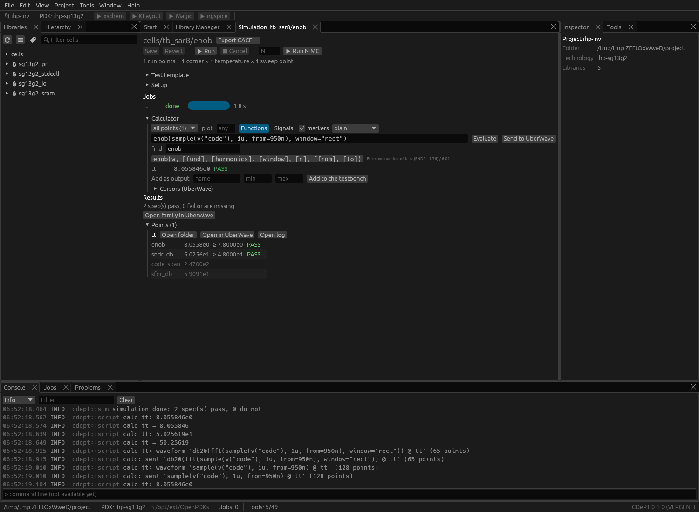

# CDePT: the measurement calculator (Phase 5)

Status 2026-11-27: readers for SPICE raw files, CSV tables and digital waveforms (VCD,
FST, GHW), a waveform function library (timing, frequency response, spectra, noise,
converters, jitter, PSD, statistics), an expression language, `[[output]]` in
`setup.toml`, `cdept calc`, and the calculator panel of the Simulation tab (§7) whose
waveforms go to the built-in UberWave. Code: `libcdept/src/raw/` (readers),
`libcdept/src/calc/` (`wave`, `measure`, `spectral`, `jitter`, `funcs`, `lang`, `sim`),
`cdept-gui/src/views/simulation/calc.rs`. Pure Rust (own radix-2 FFT, hand-written
parser); the digital reader is the `wellen` crate (BSD-3-Clause).

The idea is the one of a circuit designer's calculator (pick signals, apply functions,
get numbers); the syntax is our own and small.

## 1. Raw files (`libcdept::raw`)

```rust
let raw = RawFile::open(path)?;            // mmap + headers; ascii is parsed
raw.plots()                                // Vec<Plot>: name, kind() = tran|ac|dc|noise|op, vars, points, complex
raw.find_plot("ac")                        // by index, kind or part of the name
let w: Waveform = raw.vector(plot, "v(out)")?;   // one column copied out, x = first variable
```

ngspice and Xyce flavours, binary (little-endian doubles) and ascii, real and complex
(`Flags: complex`), several plots in one file (our runs append the analyses to
`out.raw`). A file cut short gives the points that are there
(`declared_points` says what was announced). Names are matched without regard to case
(Xyce writes `OUT`, `V1#branch`; ngspice `v(out)`, `i(v1)`). A binary plot is not read
into memory until a vector is asked for, so a 100 MB file costs only the vectors used.

`Waveform { x: Arc<Vec<f64>>, y: Samples::{Real, Complex}, x_name, x_unit, name, unit }`.
Waveforms from one plot share `x`. `value_at` interpolates linearly.

### CSV tables and digital waveforms

`RawFile::open` reads more than SPICE raw files, into the same plots and vectors, so
every function, `cdept calc --raw` and `cdept wave` work on them:

- **CSV** (`.csv`, `.tsv`, `.txt`, `.dat`, `.tab`): the first column is x, the others are
  signals. The first line that is not a comment (`#`, `%`, `*`, `//`) names the columns
  when one of its fields is not a number (else `x`, `col1`, ...). Separator: tab, comma,
  semicolon or spaces (from that line); quoted fields; SPICE suffixes (`1n`). An empty
  cell, `nan`, an infinity or text is a gap (NaN). x must be finite and must not decrease
  (equal values are allowed), else the file is refused with the line number. An x
  column called `time` or `t` makes a transient plot (`analysis="tran"`), `freq...` an AC
  one.
- **VCD, FST, GHW** (told by their content; `wellen`): one plot, `Transient (digital,
  VCD)`, whose vectors are the signals by full hierarchical name (`tb.dut.clk`); a short
  name finds the signal when only one ends so (`v("clk")`). A signal is a step waveform in
  seconds (two points per change, so a crossing lands on the edge); a bit or vector is
  its unsigned value, `x`/`z` in any bit is a gap, a `real` its value, strings and events
  gaps; the last value is held to the end of the file. Signals load when asked for.
  A damaged file is an error (the reader runs under `catch_unwind`), never a crash.

`cdept calc 'frequency(v("clk"), level=0.5)' --raw dump.vcd`;
`cdept calc 'avg(v("vout"))' --raw scope.csv`.

## 2. The language

One expression, evaluated against an `Env`: the raw file, optionally one plot, and
names. Result: a number, a complex number, a waveform or a string.

```
ugbw(v("out") / v("in"))
delay(v("in"), v("out"), level=0.6, trig_edge="rise", targ_edge="fall")
db20(value_at(v("out", analysis="ac"), 1k))
enob(clip(v("dout"), 1u, 9u), window="rect")
pkpk(v("out")) / vdd
```

- Numbers take SPICE suffixes and units: `1u`, `5p`, `1meg` (`M` is milli, as in SPICE),
  `2.5k`, `10pF`, `1e-9`. Strings are `"…"` or `'…'`.
- Operators `+ - * / ^` (`^` binds tighter than unary minus, right-associative).
  Between waveforms they work on a common grid (the union of the two x grids when they
  differ); a number is broadcast; complex waveforms give complex waveforms.
- Calls take positional and named arguments, positional first: `cross(w, 0.5, "rise", n=2)`.
  Each function's parameter list is in the table below; `[x]` is optional.
- Names (case-insensitive) are the variables of the run point: `corner` (string), `temp`
  and `temperature` (°C), `seed`/`run` (Monte Carlo), every entry of `[variables]` (swept
  values win), the `.meas` results and earlier outputs of the same testbench, and `pi`.
- Function names are case-insensitive. A signal is looked up with `v("out")` (finds
  `v(out)` or `out`), `i("vdd")` (finds `i(vdd)` or `vdd#branch`), `sig("onoise_spectrum")`.
  A name that exists in several plots (tran and ac both have `v(out)`) is an error until
  you say which: `v("out", analysis="tran")` or `plot="…"`, or set the plot for the
  whole expression (`[[output]] plot = "ac"`, `cdept calc --plot ac`). Single-point
  plots (operating point) do not count as a clash.
- Errors name the position: `cdept calc` and `[[output]]` print the line with a caret.
- Limits against hostile or mistyped input: at most 2000 tokens, parentheses, calls,
  signs and powers nested at most 64 deep; a long sum is evaluated in a loop (no stack
  overflow on any thread); functions that make points (`resample`, the FFT length `n`)
  stop at 2^24 points, `sample` at 5·10^7, `histogram` at 10^6 bins.
- In the GUI, `cursor_a` and `cursor_b` are the positions of UberWave's cursors (when
  they are on): `value_at(v("out"), cursor_a)`.

## 3. Functions

`cdept calc --functions` prints the same table (names separated by `|` are aliases).
All reductions and timing functions take `from=` and `to=` (an x range) where listed.
Real waveforms only unless said; use `mag`, `db20`, `real`, `imag`, `phase` first.

Signals: `v(name, [plot], [analysis])`, `i(…)`, `sig(…)`, `xaxis(w)`.

Elementwise (numbers, complex, waveforms): `abs|mag`, `db20`, `db10`, `phase` (degrees,
unwrapped along x), `phase_rad`, `real`, `imag`, `conj`, `sqrt`, `exp`, `ln`, `log10`,
`sin cos tan atan`, `floor ceil round`, `pow(x, y)`.

Reductions (time-weighted, trapezoid): `min(w)`, `max(w)` (also `min(a, b)` of numbers),
`minx`, `maxx` (where), `avg|mean`, `rms`, `pkpk`, `integrate(w, [from], [to])`, `len`,
`xmin`, `xmax`.

Waveform to waveform: `derivative`, `integral` (running), `clip(w, from, to)`,
`resample(w, n=|step=, [from], [to])`, `value_at(w, x)` (`at`, `interp`; complex for a
complex waveform).

Timing: `cross(w, [level=0], [edge="either"], [n=1], …)` (n=-1 is the last),
`delay(trig, targ, [level], [trig_edge="rise"], [targ_edge="rise"], [trig_level],
[targ_level], [trig_n], [targ_n])` (the target crossing is the first at or after the
trigger; `level` is both thresholds, like `.meas` `val=`), `rise_time`, `fall_time`
(`lo=0.1 hi=0.9`, swing `vlow..vhigh`, default the waveform's min and max), `slew`
(V/s of the 10-90 % part), `overshoot`, `undershoot` (percent), `settling_time(w, tol=0.02)`,
`frequency`, `period`, `duty` (percent).

Frequency response (the complex AC result, or its magnitude): `bandwidth(w, drop=3)`,
`unity_gain_freq` (`ugbw`), `phase_margin`, `gain_margin`. These interpolate on log x.
Margins take the complex loop gain with the sign of the feedback included, so its phase
starts near 0. `phase_margin` is 180 plus the unwrapped phase at the unity-gain
frequency, `gain_margin` is minus the gain in dB where the phase reaches -180.

Spectra: `fft(w, window="hann", n, from, to)` (a complex waveform over frequency,
magnitude = peak amplitude, window gain corrected), and, on the time waveform directly,
`sndr`, `snr`, `thd` (dB, negative), `thd_percent`, `sfdr`, `enob`, `fundamental`, all
with `fund` (Hz, default the largest bin), `harmonics=5` (2nd to 5th, folded back below
fs/2), `window` (`rect`, `hann`, `blackman`), `n`, `from`, `to`. A uniform waveform with a
power-of-two number of points is used as it is; anything else (SPICE's adaptive steps) is
resampled to `n` points over `from..to` by linear interpolation, giving a whole number of
signal cycles in that range keeps the figures coherent. Signal power is the tone bin and
the window's main lobe; harmonic bins likewise; the rest is noise.

Jitter (crossings of `level`, default mid-swing, on `edge`, default rise; `from`/`to`):
`periods(w)` (a waveform of every period over its start time), `period_jitter(w,
[stat])`, `cc_periods(w)` (differences of consecutive periods), `cc_jitter(w, [stat])`,
`tie(w, [period])` (time interval error of every crossing against the ideal clock: the
least-squares fit of the crossings, or `period` placed at the mean error), `tie_jitter(w,
[stat], [period])`, `crossings(w)` (the crossing times over their number). `stat` is
`rms` (the standard deviation, default), `pp` (peak to peak), `mean` or `max` (largest
magnitude, the JEDEC cycle-to-cycle figure).

Statistics and sampling: `histogram(w, [bins=50], [min], [max], [weight])` (counts over
the bin centres; `weight="time"` counts the x span each sample stands for),
`stddev(w)`, `percentile(w, p)`, `median(w)`, `sample(w, period, [from], [n])`
(zero-order hold: the value at or just before each instant, e.g. an ADC code read once
per conversion: `enob(sample(v("code"), 1u, from=950n), window="rect")`).

Power spectral density: `psd(w, [window="hann"], [n], [segments=8], [from], [to])`,
Welch's method (50 % overlapping segments of n points, the mean removed per segment),
one-sided, unit²/Hz, so its integral is the variance; uniform data is used as it is,
SPICE steps are resampled. `db10(psd(...))` is dB/Hz, `sqrt(psd(...))` unit/√Hz.

Noise: `integrate_noise(w, [from], [to], [squared])` (density V/√Hz to V rms, trapezoid),
`spot_noise(w, f)`.

Converters: `dnl`, `inl` (waveforms over the code, LSB), `dnl_max`, `inl_max`. `w` is
the output code. `method="edge"` (default): the code against a swept input, transitions
found at code-0.5 crossings, end-point fit unless `lsb=` is given. `method="hist"`: the
code sampled over a uniform ramp, widths from the counts (end codes left out).

## 4. In a simulation

```toml
[[output]]
name = "gain_db"
expr = 'db20(value_at(v("out", analysis="ac") / v("in", analysis="ac"), 1k))'
[[output]]
name = "pm"
expr = 'phase_margin(v("out", analysis="ac") / v("in", analysis="ac"))'
[[spec]]
name = "pm"
min = 60
```

After each run `cdept sim run` opens `out.raw` and evaluates the outputs in order. A
number joins the run's measures (an output wins over a `.meas` of the same name), is
checked against specs like any measure and is stored in `result.json` and
`results.db`. `result.json` lists the calculator's names in `calc` and failed ones with
the message in `calc_errors`; the table of `cdept sim run` marks the column with `*` and
prints the errors under the row. An output that fails (or is not a finite number) is
missing, so a spec on it fails. `plot = "ac"` limits the lookups of one output.
Expressions are parsed when the setup loads, so a typo is reported before any
simulation. Xyce raws work the same way.

## 5. Ad hoc

```
cdept calc 'delay(v("in"), v("out"), 0.6, trig_edge="rise", targ_edge="fall")' \
    --raw simulations/cells/tb_inv/testbench/tt_27/out.raw --var vdd=1.2
cdept calc --raw out.raw --list            # plots and vectors
cdept calc 'v("out", analysis="tran")' --raw out.raw --dump    # x y per line
```

## Sending a result to UberWave

`cdept wave <lib> <cell> --view V [--point P | --family | --points a,b] --calc 'EXPR' [--name N]`
evaluates the expression on the raw file of each chosen point and pushes waveform results
to [UberWave](howto/view-waveforms.md) as traces (a viewer with IPC is needed). The Simulation
tab has the same in its calculator panel (§6). Scalars are printed (a table per point for a family).

Signals are written with quoted names, `v("out")`: a bare `out` is a variable name of the
language. In `cdept wave --calc` only, an expression that fails as written is tried once more
with the plain name inside `v( )` and `i( )` quoted, so `v(out)` and `i(vdd)` work there
too; an expression that is valid as written is never changed (a variable named like the
node keeps its meaning). When it still fails, the error ends with `hint: write node names
in quotes: v("out")`. `cdept calc` and `[[output]]` stay strict.

## 6. The calculator panel (GUI) and the viewer

The Simulation tab has a **Calculator** section (under Jobs, above Results) for the open
testbench, on the run points on disk (also of earlier sessions):

- the point (or all points: a family), the analysis to look in (`plot`);
- the expression, with completion buttons for function names, the signature and help of
  the function being typed or called, a **Functions** browser (search in names and
  help; a click inserts `name(`) and a **Signals** browser of the point's raw file (a
  click inserts `v("...")`, `i("...")` or `sig("...")`, with `analysis=` when the file
  has several plots);
- **Evaluate**: the result per point in a table (numbers; PASS/FAIL when the testbench
  has an output of the same expression with a spec), errors with their position;
- **Send to UberWave**: the same, and waveform results go to the built-in UberWave as
  traces, laid out *plain* (the active pane, or a pane of the same X unit: a spectrum
  never lands on a time axis), *Bode* (a complex result: magnitudes in one new pane,
  phases in another, log frequency) or *eye* (every period from an offset drawn on top
  of the others, X from 0 to the period); with **markers** on, the places scalar results
  were measured are marked in the viewer (crossings, trigger and target of a delay, the
  10/90 % points of an edge, the settling time, extremes, `value_at`), labelled with the
  expression and the value; each send replaces them;
- **Send to tab**: the same into a waveform tab of CDePT's own viewer (the newest tab of
  the testbench view, else a new one), with the same layouts: *Bode* puts the
  `(mag dB)` traces into a pane and the `(phase)` ones into the pane below on a log
  frequency axis, with the unity gain, phase margin and gain margin of every point as
  markers; *eye* folds each trace in a pane of its own
  ([view waveforms](howto/view-waveforms.md#analyses));
- **Add as output**: name, min, max: the expression becomes an `[[output]]` of the setup
  form (and a spec); Save keeps it, the next run has it in the spec table;
- **Cursors (UberWave)**: follows the built-in viewer's cursors live (UberWave reports
  each move to CDePT, no polling): A, B, B−A, 1/(B−A), the plotted signals under A and B,
  and every output whose expression uses `cursor_a`/`cursor_b`, evaluated again on the
  chosen point when a cursor moves, with its spec verdict.

The same from the shell: `cdept wave <lib> <cell> --view V --point P --calc EXPR
[--bode | --eye PERIOD[,OFFSET]] [--no-markers]`.



## 7. Tests

Unit tests use synthetic waveforms (and for the readers: tables of every kind and
broken ones, a VCD, an Icarus Verilog FST in `libcdept/src/raw/testdata`, cut files,
binary noise, headers that lie about their counts): sine with a 1 % third harmonic (THD -40 dB, SFDR 40
dB, all three windows), quantised sines of 6/8/10 bits (ENOB within 0.3), a noisy sine
(SNR), an irregular time grid, an RC step (10-90 % rise `tau ln 9`, settling, slew), a
second-order step (overshoot 16.3 %), a two-pole amplifier (UGBW, phase margin,
bandwidth), a synthetic ADC (DNL/INL by edges and histogram), ngspice-style binary and
ascii raws with several plots, truncated files. Real: `libcdept/tests/real_sim.rs`
(`calculator_outputs_match_the_meas`): the calculator's `delay` on `tb_inv`'s `out.raw`
equals the `.meas` `tpd`; jitter (a clock with known edge moves: periods, cycle to cycle,
TIE), PSD (a tone's power and white noise's variance), histograms, percentiles,
sample-and-hold; `hostile_expressions` (deep nesting, a 100000-term sum, division by
zero, type errors, huge `n`, non-ASCII names) on a 2 MB stack; and `raw::tests::real_xyce_raw_reads_like_ngspice` reads a
Xyce raw (skipped without Xyce; `CDEPT_XYCE`).
