# The graphical interface

`cdept` with no command opens the window. `cdept -p <folder>` opens it on a project;
without `-p` it opens the project the current folder belongs to, if any, and otherwise the
Start tab. The window needs a display (X11 or Wayland); the command line does not.

This page is a tour of what is on screen. The commands behind most of it are in
[The command line](cli.md), and the concepts in [Projects](../concepts/projects.md),
[Technology](../concepts/technology.md) and [Simulation](../concepts/simulation.md).

## The main window

The window is made of dockable tabs. Drag a tab to move it, split an area by dropping a
tab on its edge, and right-click a tab to float it in the window or open it in a window of
its own. The default arrangement:

| Area | Tabs |
|---|---|
| Left | Libraries, Hierarchy |
| Center | Start, and the documents you open (schematics, layouts, files) |
| Right | Inspector, Tools |
| Bottom | Console, Jobs, Problems |

Above the tabs are the menu bar and a toolbar that shows the project name, the PDK in use
(`$PDK_ROOT` and `$PDK` as resolved for the project), launch buttons for the external tools
(xschem, KLayout, Magic, ngspice) and buttons of the active document.
**Window > Reset Layout** restores the arrangement above and closes the extra windows. The
layout, the extra windows and the list of recent projects are kept
under `$XDG_DATA_HOME` ([Environment variables](../reference/environment.md)).

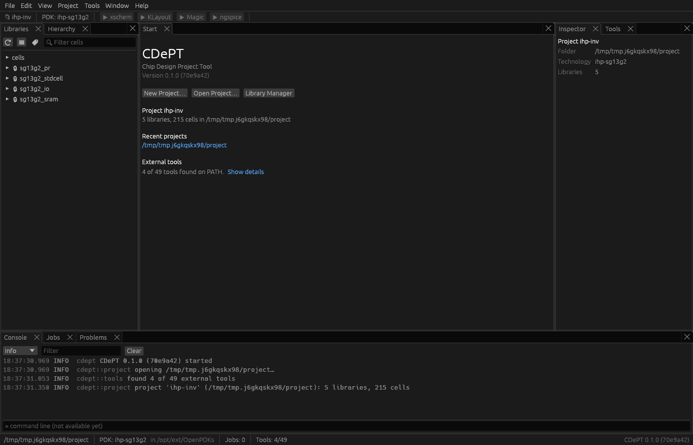
*The main window on the example project ihp-inv: the Libraries tab on the left, the Start tab in the center, the Inspector and Tools on the right, the Console below.*

### Menus

| Menu | Content |
|---|---|
| File | New Project, Open Project, Import (an existing design folder), Recent Projects, Close Project, the active document's entries (export), Quit (Ctrl+Q) |
| Edit | Undo, Redo, Cut, Copy, Paste, Select All, routed to the document in front |
| View | Theme (light, dark, system), Zoom of the whole interface |
| (document menus) | The menus of the document in front: Layout, Cell, xschem's own menus |
| Project | Reload, Copy Project File Path, Project Settings, Technology, background tasks |
| Tools | Library Manager, import tools, Detect Tools |
| Window | Show or hide each panel, the open documents, Open Document in New Window, Reset Layout |
| Help | About |

Project Settings edits the name, description, technology (PDK) and PDK folder; they are
written to [`cdept.toml`](../reference/files/cdept-toml.md) and
[`cdept.local.toml`](../reference/files/cdept-local-toml.md). Reload reads the project file
and the library folders again. CDePT also follows changes on disk (cells made or renamed
by other programs, edits to `cdept.toml`, git state) and updates the views by itself.

## The Start tab

Buttons for New Project and Open Project, the recent projects, and a line saying how many
external tools were found on `PATH`, with a link to the Tools tab.

## New Project wizard

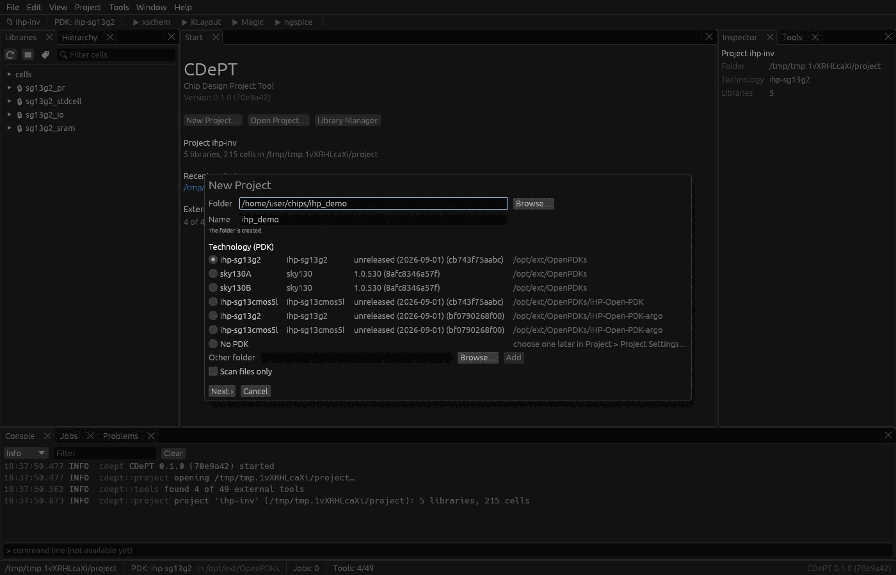
*First page: folder, name and the PDKs found on this machine.*

File > New Project asks for a folder, a name and a PDK on one page. The list of PDKs comes from
the places CDePT looks in (`$PDK_ROOT`, `~/.ciel`, ...); the menu "Installed PDKs" and
the "Other folder" field add more. **Next** scans the PDK in the background and shows what
was found (layers, decks, model corners, libraries, devices) and its notes; **Create**
writes the project with its `tech.toml`. "No PDK" makes a bare project. It is the same as
`cdept init --technology`; see [New project](../howto/new-project.md).

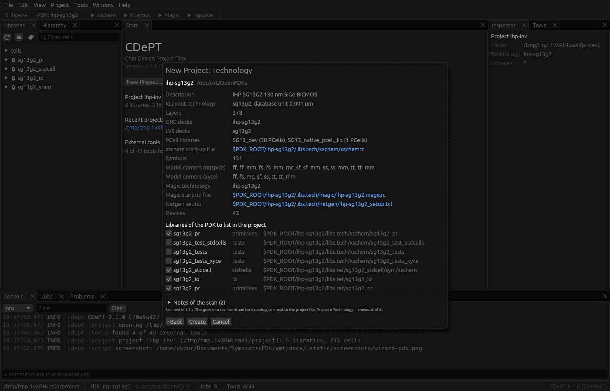
*Second page: what the scan of the PDK found, and its libraries.*

## Libraries and the Library Manager

The **Libraries** tab is a tree of libraries, cells and views. A single click selects, a
double click opens a view in the right tool. Read-only libraries (the PDK's) are marked with a lock,
and git status marks (untracked, modified, ...) appear per view, cell and library.

The **Library Manager** (Tools menu, or the Start tab) shows the same in three columns:
libraries, cells of the selected library, views of the selected cell. It has a filter
field for cells, and the buttons **+ Library**, **+ Cell**, **+ View** and Reload. A
Library menu appears while it is in front.

Right-click gives the context menus:

- Library: New Cell, Properties (folder, layout, read-only, description), Remove Library,
  Copy Folder Path, Fix all schematic links.
- Cell: New View, Copy, Rename, Delete (to the trash; it lists what uses the cell first),
  Netlist to View, Run Simulation.
- View: Open, Open in Qucs-S for a Qucs schematic, Simulation, Run Simulation, Delete.

Rename, copy and move rewrite the references in other schematics, layouts, netlists and
HDL files, and roll back if one fails.

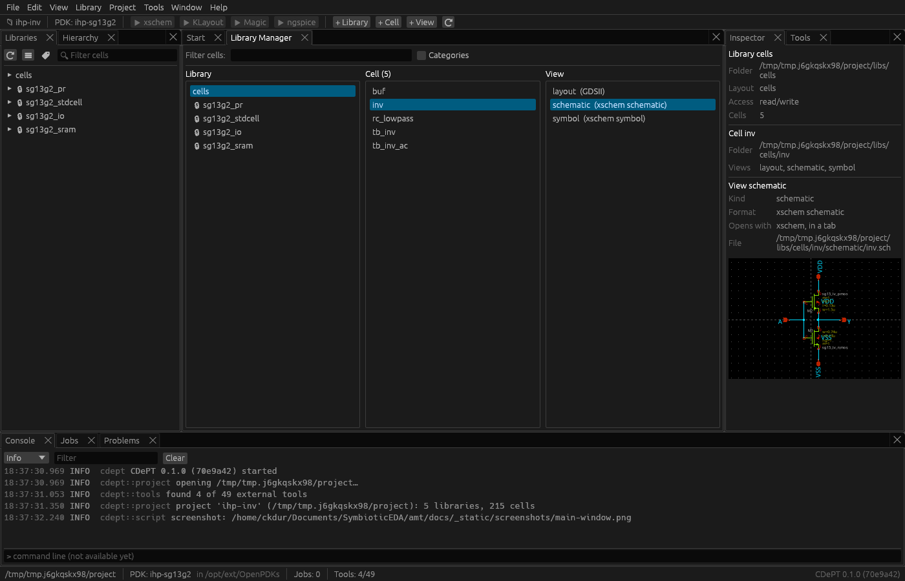
*The Library Manager: libraries, cells and views, with the Inspector showing the selected view.*

## Hierarchy, Inspector, Tools

- **Hierarchy** shows the cell in front (or the one selected) as a tree, read from the
  files: the schematic, layout, netlist or HDL hierarchy, or **Used By**, the cells that
  use it. With "Instances" ticked, the schematic tree has one line per instance, read by
  xschem.
- **Inspector** shows the details of the selection: of a schematic object while a
  schematic is in front, else of the library, cell or view selected, with a picture of a
  schematic or symbol view.
- **Tools** lists the external tools found and the embedded helpers, with the version
  and the path of each (the `cdept tools` list, plus `cdept-xschem`). Detect Tools in the
  Tools menu probes again.

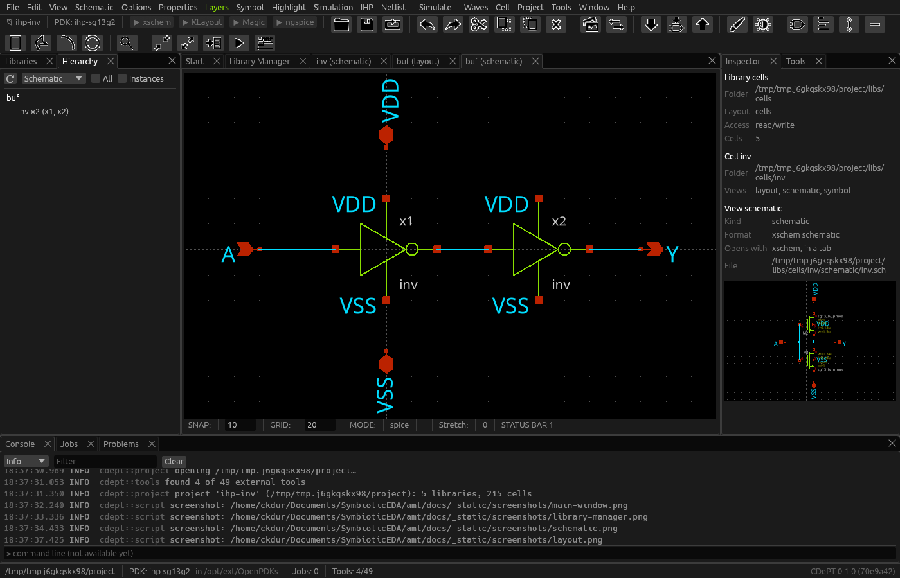
*The Hierarchy panel showing buf, which uses inv twice.*

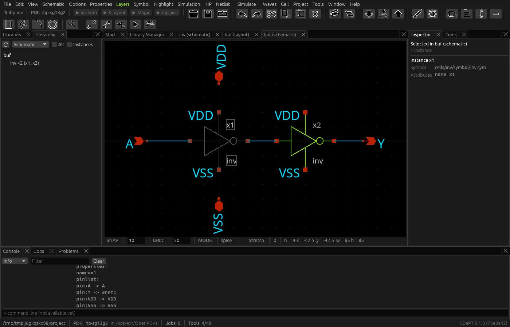
*The Inspector showing the instance x1 selected in a schematic.*

## Console, Jobs, Problems

The **Console** shows the log (the output of `-v` on the command line). **Jobs** and
**Problems** are placeholders: simulation jobs are shown in the Simulation tab, and
DRC and LVS results in the layout tab. Background work (reading the hierarchy, scans)
is listed in the Project menu.

## Search and quick open

**Ctrl+P** (Go to Cell) or **Ctrl+Shift+F** opens a box that searches cell names as you
type. **Enter** selects the cell; **Shift+Enter** or **Ctrl+Enter** opens a view of it
(the schematic, else the symbol, else the layout). While a schematic is in front, Ctrl+P
belongs to xschem (add pin); use Ctrl+Shift+F. The shortcuts work in the main window only.

The **Search** tab (Window menu) has the same query with widgets: library, view kind
and category filters, and **Inside files** to look for words in schematics,
symbols, netlists and HDL (pins, instances, text). The query words (`lib:`, `kind:`,
`cat:`, patterns with `*` and `?`) are those of `cdept find`; see the
[command reference](../reference/cli.md). Categories are managed from the Categories menu
of the library views ([Category files](../reference/files/categories.md)).

## Schematic tabs

Opening a schematic or symbol starts the embedded xschem engine, and its editor appears in
the tab: the drawing, xschem's menus, dialogs and key bindings are xschem's own, the
pixels are drawn by the helper and the mouse and keys are sent to it. Notes:

- Menus **Cell** (Netlist to View, Select in Libraries, link actions) and **File >
  Export** (netlist formats, SVG) are CDePT's, next to xschem's.
- Netlisting and Simulate run as background jobs.
- Editing a schematic whose file changes on disk behind the tab asks what to do; closing a
  changed one asks to save.

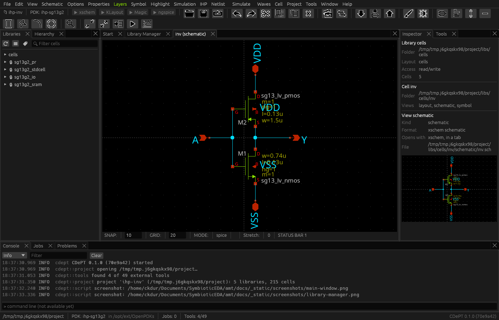
*The schematic of inv in the embedded xschem.*

What the embedded xschem can and cannot do is in [XSCHEM.md](../XSCHEM.md).

## Layout tabs

A layout view opens in the embedded KLayout: a headless editor whose picture shows in
the tab, with CDePT panels for **Layers**, **Cells** and **Selection** (tick "Layers,
Cells and Selection" in the tab). The **Layout** menu has Place Cell (another layout view
of the project), Place Library Cell (KLayout's and the PDK's PCells), Properties, Delete, Mode
and Zoom, Run DRC, Run LVS, the schematic link actions (Generate and Update from
Schematic, the Link, Pins and Nets panels) and Save Layout.

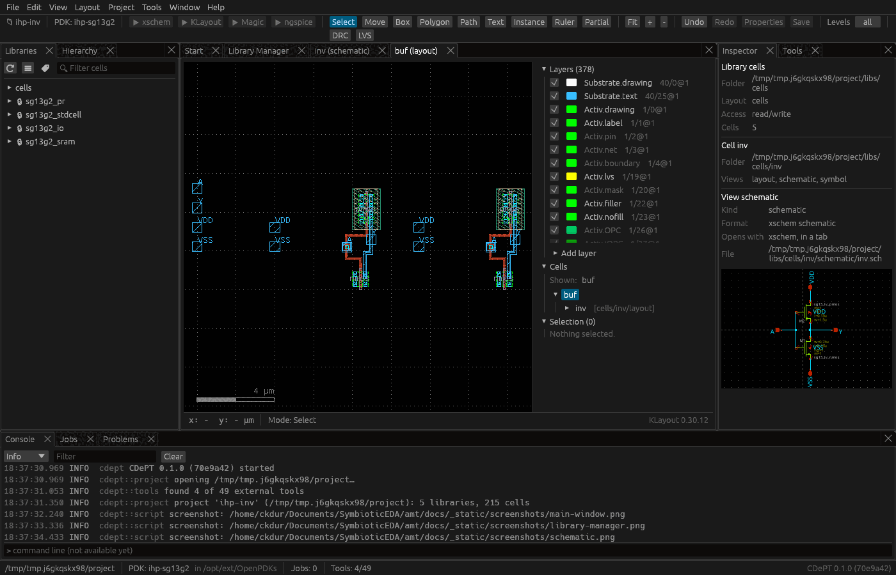
*The layout of buf in the embedded KLayout, with the Layers, Cells and Selection panels.*

| Key | Action |
|---|---|
| Ctrl+Z, Ctrl+Y | Undo, redo |
| Ctrl+S | Save |
| F2 | Zoom to fit |
| Ctrl++, Ctrl+- | Zoom in, out |
| Q | Properties of the selection |
| Del | Delete the selection |
| N | Probe nets with the mouse |
| Shift+X, Shift+B, Ctrl+Shift+B | Edit in place: descend into the cell, return one level, return to the top |

A layout that references other layout views shows them as cells filled from their files;
a missing one shows as a red X. Saving writes the layout and its `.gds.json` sidecar. See
[KLAYOUT.md](../KLAYOUT.md) and [LINKING.md](../LINKING.md).

A **LEF abstract** (an `abstract` view whose file is a `.lef`, e.g. a standard cell of a
PDK) opens in the same tab, **read-only**: the picture is what KLayout's LEF reader makes
of the file (pins, obstructions and the macro boundary each on layers of their own, named
after the LEF's layer, with the PDK's colours where its layer properties have them), the
macro of the view is shown and the other macros of the file are in the Cells panel.
Zoom, the panels, rulers and the selection work; the drawing modes, Place Cell, Delete
and Save are refused with the notice "LEF abstract: read-only". Nothing is converted or
written next to the LEF. Double-click the view in the Library Manager to open it.

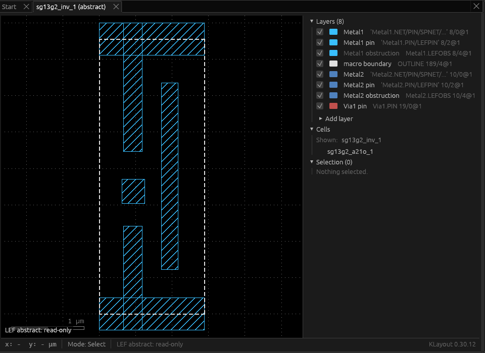
*The abstract of `sg13g2_inv_1` from IHP's `sg13g2_stdcell.lef`: Metal1 pins in the PDK's colours, the cell boundary dashed.*

## Technology tab

Project > Technology opens what CDePT read out of the PDK. A selector at the top chooses the
page: Overview, Layers, Layout tools (KLayout, Magic, netgen set-ups and decks), Models
(files and corners), Devices, Libraries, Notes, and Everything. A filter box narrows the
lists. From here you can rescan the PDK (with an offer to reopen tabs that were open),
list or leave out a PDK library, The data is [`tech.toml`](../reference/files/tech-toml.md).

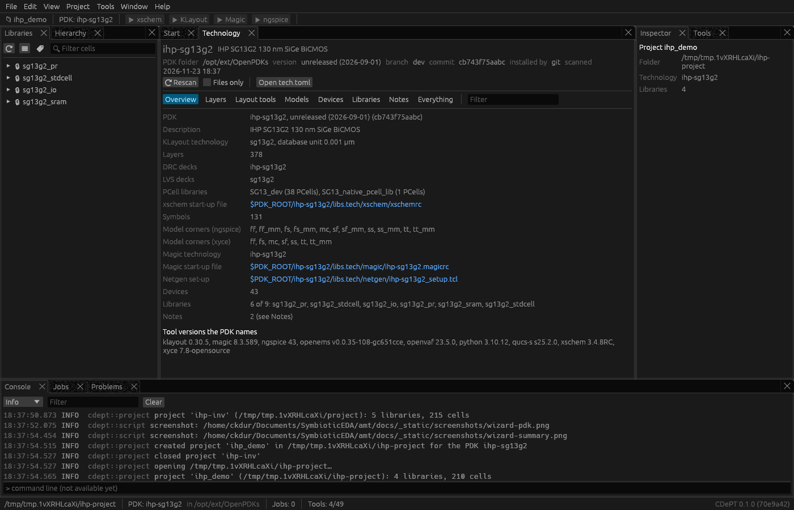
*The Technology tab, Overview page, for IHP SG13G2.*

## Simulation tab

Opening a testbench view (double click on it, or Simulation in the view's menu) shows
its [`setup.toml`](../reference/files/setup-toml.md) as a form and, below it, the runs.

- The toolbar has **Save**, **Revert**, **Run**, **Cancel**, and **Run N MC** and **Grid**
  for Monte Carlo and the full grid.
- The form edits the test template and its parameters, corners, temperatures, design
  variables, options, analyses, measures, saves, specs and sweeps. Saving keeps the
  comments at the top of the file and what the form does not show.
- **Jobs** lists the simulator processes of the run with their state; **Results** shows
  one row per point with the spec columns, PASS or FAIL, and Monte Carlo statistics.
- A suite view shows one combined table of the points of all its tests.

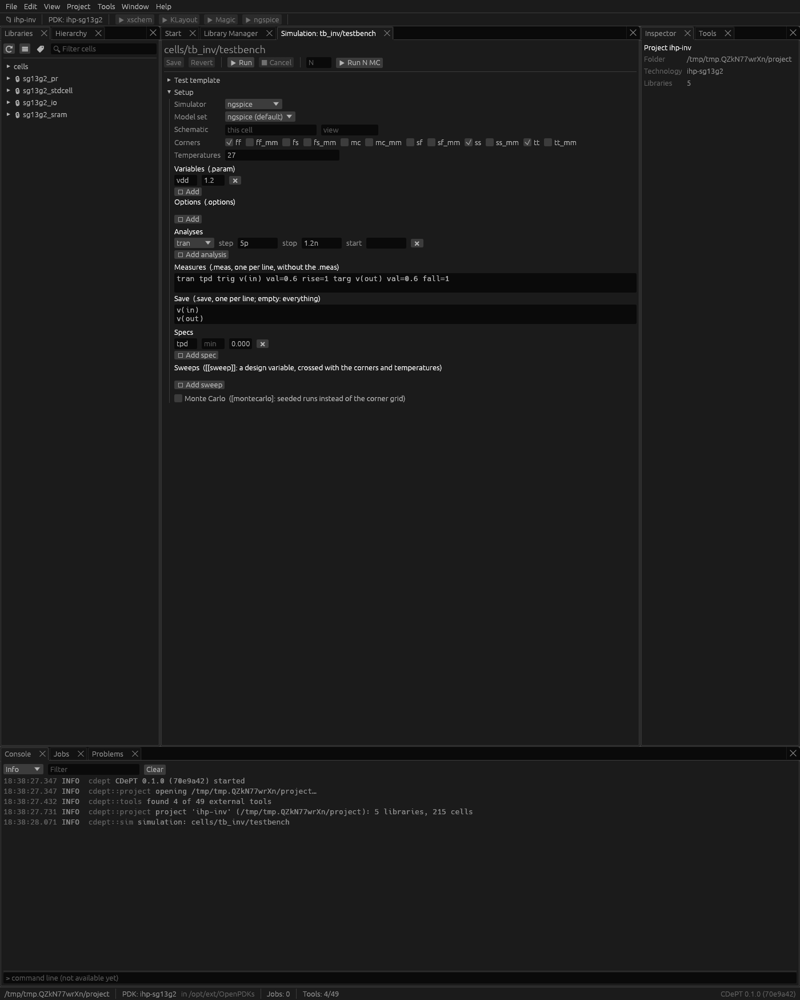
*The setup form of the testbench tb_inv.*

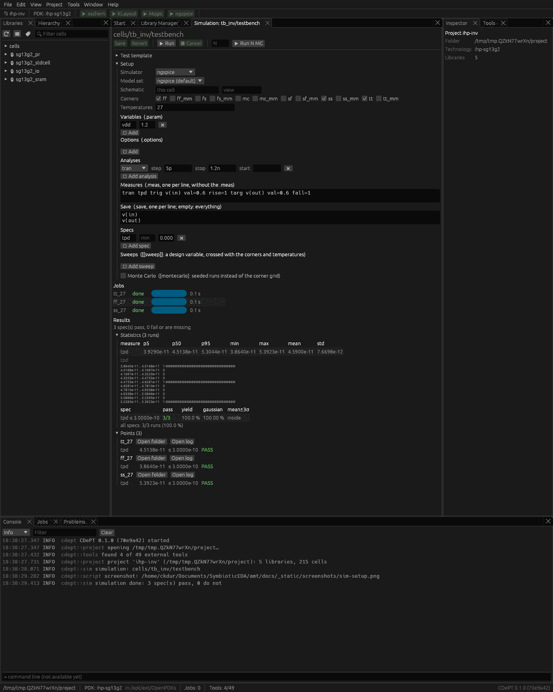
*After a run: Jobs, Results with statistics, and the points with PASS rows.*

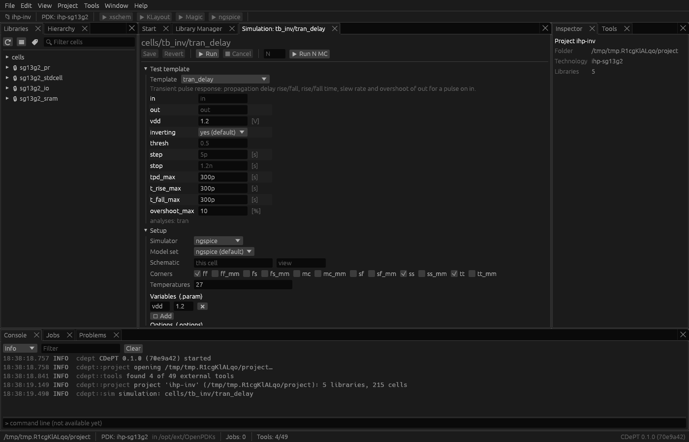
*A testbench that starts from a test template: the picker and its parameters above the setup.*

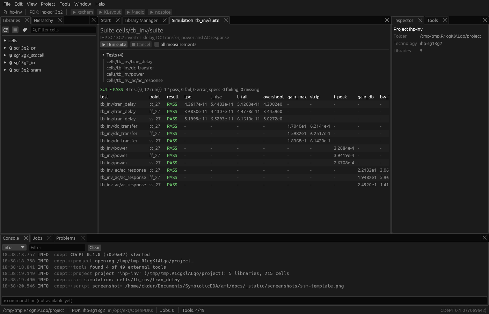
*A suite run: the tests listed, and one table with a row per point.*

Each point of the Results list has **Open in UberWave**, which starts the separate UberWave
viewer on the point's raw file ([View waveforms](../howto/view-waveforms.md)); CDePT has no
waveform viewer of its own. With a viewer that has IPC, **Open family in UberWave** shows all
the points in one window, and the expression line under it (a calculator expression, a point
or all points, **Send**) pushes the result into the running viewer as traces; scalar results
and errors appear under the line. Typing the start of a function name offers it as a button.

Details of the model are in [Simulation](../concepts/simulation.md).

## Scripting and testing the GUI

`cdept gui --script <file>` runs the real window and executes a script of commands in order:
open a view, move the mouse, press keys, take screenshots. It is how the GUI is tested.
The command list is in [GUI-TESTING.md](../GUI-TESTING.md).

## See also

- [The command line](cli.md)
- [Quickstart](quickstart.md)
- [GUI-TESTING.md](../GUI-TESTING.md)
- [XSCHEM.md](../XSCHEM.md), [KLAYOUT.md](../KLAYOUT.md)
