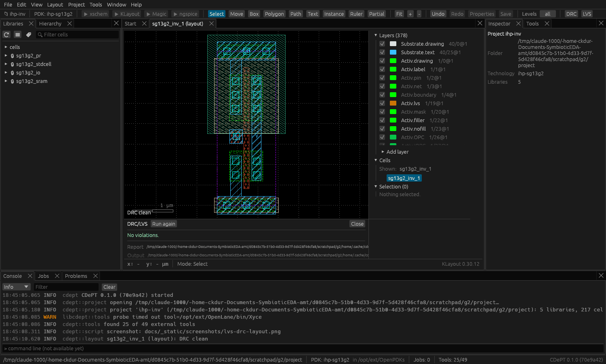
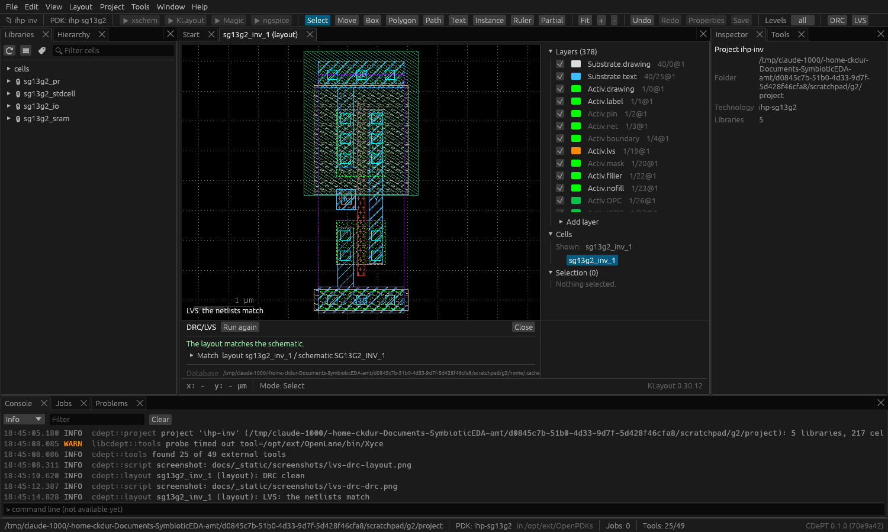

# Run DRC, LVS and extraction

This page runs every layout check CDePT has on a real, clean layout: the standard cell
`sg13g2_inv_1` of the IHP SG13G2 PDK (the same steps work for `sg13g2_nand2_1` and,
with two extra switches, for `sky130_fd_sc_hd__inv_1`). The checks:

| Check | Tool | Command | Where it is available |
|---|---|---|---|
| DRC with the PDK's deck | KLayout (batch) | `cdept layout drc` | CLI and GUI (Layout menu) |
| LVS with the PDK's deck | KLayout (batch) | `cdept layout lvs` | CLI and GUI (Layout menu) |
| Net comparison with the schematic, pins | CDePT, with KLayout | `cdept layout check-nets`, `pins` | CLI and GUI, see [LINKING.md](../LINKING.md) |
| Extraction to SPICE | Magic | `cdept magic extract` | CLI only |
| DRC with Magic's rules | Magic | `cdept magic drc` | CLI only |
| LVS between two SPICE netlists | netgen | `cdept netgen lvs` | CLI only |

How each tool works is not repeated here: see [KLAYOUT.md](../KLAYOUT.md) section 8,
[MAGIC.md](../MAGIC.md) and [BATCH.md](../BATCH.md). The exit status of every check is
non-zero when it finds problems, so the commands can gate a script or CI job. The
examples need `PDK_ROOT=/opt/ext/OpenPDKs` and the tools of `/opt/ext/OpenLane/bin` on
`PATH`.

## Get a standard cell into the project

The PDK's cells are in the read-only library `sg13g2_stdcell`, but all 84 cells are one
GDS file (`gds/sg13g2_stdcell.gds`) and one SPICE file. Copy the cell into a library of
your own: the copy gets a GDS with just that cell (and the cells it places) and a
netlist with just its `.subckt`, each named after the new cell. Work in a scratch copy
of `examples/ihp-inv`:

```sh
cp -r examples/ihp-inv /tmp/lvs-demo && cd /tmp/lvs-demo
C=sg13g2_inv_1
cdept cell copy sg13g2_stdcell $C $C --to cells
cdept ls cells        # sg13g2_inv_1 now has layout, netlist, schematic and symbol views
```

The command prints what it does: the structure taken out of the PDK's GDS, the
subcircuit taken out of its SPICE and CDL files, and the files that are copied as they
are (the cell's schematic and symbol). The views that are one cell of a larger file and
cannot be taken apart (LEF, Verilog, Liberty) are named in notes and left out. Use
`--dry-run` to see the plan first. The cell itself stays in the read-only library: it
cannot be renamed, moved or deleted.

LVS needs a schematic. The PDK has one for the cell, so the copy has it; for a cell
without one, draw it or copy another cell's schematic.

The PDK writes the two transistors of the netlist as subcircuit calls
(`XN0 ... sg13_lv_nmos`); KLayout reads a netlist with no models, so to compare against
the copied netlist (not the schematic) they must be MOS devices (`M...`):

```sh
sed -i 's/^X\([NP]\)/M\1/' libs/cells/$C/netlist/$C.spice
```

```{note}
DRC can also be run on the cell in place (`cdept layout drc sg13g2_stdcell sg13g2_inv_1`,
or Run DRC on the cell's layout): the check works on the cell named, not on the first
cell of the library's GDS file. LVS needs a schematic of the cell, so for LVS copy the
cell into a library of the project as above.
```

## What is taken from the technology

| Needed | Taken from |
|---|---|
| KLayout DRC deck | `[klayout] drc` of `cdept.toml`, else the first `klayout.drc` entry of `tech.toml`, else the first `*.drc` in the `KLAYOUT_PATH` folders |
| KLayout LVS deck | `[klayout] lvs`, else the first `klayout.lvs` entry, else the first `*.lvs` |
| KLayout technology | `[klayout] tech`, else `klayout.tech` |
| Magic start-up file | `magic.rc` (else `$PDK_ROOT/$PDK/libs.tech/magic/$PDK.magicrc`) |
| Magic extraction and DRC style | the first entry of `magic.extract` and `magic.drc`, unless `--style` is given |
| netgen set-up | `netgen.setup`, else `--setup`, else an empty one |

`cdept tech show klayout` shows the decks the project will use. To use another deck
permanently, set `[klayout] drc` or `lvs` in `cdept.toml`; for a single run use
`--deck FILE`.

Program locations: `klayout` through the embedded helper; Magic is `$CDEPT_MAGIC` else
`magic` on `PATH`; netgen is `$CDEPT_NETGEN` else `netgen` on `PATH`. See
[Environment variables](../reference/environment.md).

## DRC with a KLayout deck

```sh
cdept layout drc cells sg13g2_inv_1
```

CDePT writes a self-contained GDS of the cell, runs the PDK's deck
(`ihp-sg13g2.drc`) with `klayout -b`, and reads the report:

```text
deck    /opt/ext/OpenPDKs/ihp-sg13g2/libs.tech/klayout/tech/drc/ihp-sg13g2.drc
layout  ~/.cache/cdept/verify/ihp-inv/cells/sg13g2_inv_1/drc/sg13g2_inv_1.gds (top cell sg13g2_inv_1)
report  ~/.cache/cdept/verify/ihp-inv/cells/sg13g2_inv_1/drc/sg13g2_inv_1.lyrdb
DRC clean
```

`sg13g2_nand2_1` is clean as well, and so is `sky130_fd_sc_hd__inv_1` in a sky130A
project (it runs the first deck of that technology, `sky130A_mr.drc`). No special deck
options were needed: the cells are clean with the default deck.

Options: `--view VIEW` picks the layout view when a cell has several, `--deck FILE` runs
another deck, `-D NAME=VALUE` passes further variables to the deck (`-rd` of KLayout; the
deck always gets `input`, `topcell` and `report`), `--dir DIR` chooses the output folder.

Results land in `~/.cache/cdept/verify/<project>/<library>/<cell>/drc/`: the stream that
was checked (`<cell>.gds`), `<cell>.lyrdb` (KLayout's marker database, open it in
KLayout) and `drc.log`.

### In the GUI

Open the cell's layout and choose **Layout > Run DRC** (or the DRC button). The check
runs in the background on the layout as it is now, unsaved edits included. Violations
appear in a results panel; clicking one highlights the shapes and zooms to them. There is
no cancel button.



*Run DRC on the standard cell: the panel under the layout reports no violations.*

## LVS with a KLayout deck

Against the PDK's netlist:

```sh
cdept layout lvs cells sg13g2_inv_1 --netlist libs/cells/sg13g2_inv_1/netlist/sg13g2_inv_1.spice
```

or, with the schematic view made above (xschem netlists it in LVS form):

```sh
cdept layout lvs cells sg13g2_inv_1
```

```text
deck    /opt/ext/OpenPDKs/ihp-sg13g2/libs.tech/klayout/tech/lvs/sg13g2.lvs
layout  ~/.cache/cdept/verify/ihp-inv/cells/sg13g2_inv_1/lvs/sg13g2_inv_1.gds (top cell sg13g2_inv_1)
netlist libs/cells/sg13g2_inv_1/netlist/sg13g2_inv_1.spice
Match            layout sg13g2_inv_1 / schematic SG13G2_INV_1
report  .../lvs/sg13g2_inv_1.lvsdb
extracted .../lvs/sg13g2_inv_1_extracted.cir
```

Options are those of DRC plus `--schematic VIEW` (the schematic view, when the cell has
several) and `--netlist FILE`, which compares with a SPICE netlist you provide. A match
exits 0. `sg13g2_nand2_1` matches the same way.

Results land in `.../<cell>/lvs/`: the stream, `<cell>.spice` (schematic netlist, when
there is no `--netlist`), `<cell>.lvsdb` (what the GUI's net highlighting reads),
`<cell>_extracted.cir`, `lvs.log`, `summary.json` and `summary.log`.

In the GUI use **Layout > Run LVS**:



*Run LVS on the same cell: the panel reports a match with the schematic.*

Two related checks need no deck and are quicker for day-to-day work:
`cdept layout check-nets` (opens, shorts, unconnected terminals, pins without labels) and
`cdept layout pins`, described in [LINKING.md](../LINKING.md) sections 8 and 9.

### The same cell in sky130A

In a project made with `cdept init --technology sky130A` (add `cells = "libs/cells"` under
`[libraries]`), cut `sky130_fd_sc_hd__inv_1` out of
`libs.ref/sky130_fd_sc_hd/gds/sky130_fd_sc_hd.gds` the same way, and use the
`.subckt` of `spice/sky130_fd_sc_hd.spice` (again with `X` turned into `M`). DRC is clean.
LVS needs two deck variables, because the standard cell has no substrate tap and the
PDK's netlist has widths such as `w=650000u`:

```sh
cdept layout lvs cells sky130_fd_sc_hd__inv_1 --netlist .../sky130_fd_sc_hd__inv_1.spice \
    -D lvs_sub=VNB -D scale=true
```

`lvs_sub=VNB` names the substrate net after the cell's `VNB` pin (the deck's default is
`sky130_gnd`) and `scale=true` makes the deck write sizes in the netlist's units. Without
them the result is a mismatch of one net and the sizes, although the layout is right.

## Extraction and DRC with Magic

Magic is run as a separate program in batch mode with the PDK's start-up file. It reads
the cell's `.mag` view or a GDS view.

```sh
cdept magic extract cells sg13g2_inv_1   # layout to SPICE
cdept magic drc cells sg13g2_inv_1       # PDK DRC rules, style drc(fast)
cdept magic drc cells sg13g2_inv_1 --style 'drc(full)'
```

```text
magic/cells/sg13g2_inv_1/sg13g2_inv_1.spice
  .subckt sg13g2_inv_1 (4 ports)
      1 x sg13_lv_nmos
      1 x sg13_lv_pmos
cells/sg13g2_inv_1: DRC clean (drc(fast))
cells/sg13g2_inv_1: DRC clean (drc(full))
```

Both styles are clean for the IHP cell and for `sky130_fd_sc_hd__inv_1`. `--style` takes a
style name of the technology (`cdept tech show magic` lists `extract` and `drc`); `magic
drc` exits 1 when the layout is not clean and prints the rules violated. `cdept magic lef`
writes a LEF abstract. Results land in `<project>/magic/<library>/<cell>/`: the `.spice`
and Magic's `.ext` files, `<cell>.drc.json` (violations by rule with boxes in micron).
These commands have no GUI equivalent.

Magic's rules and KLayout's deck are different checks: a layout can pass one and fail the
other. A PDK's signoff deck is normally the KLayout one.

## LVS with netgen

`cdept netgen lvs` compares two SPICE netlists, each with the name of the cell:

```sh
cdept netgen lvs <layout.spice> <cell> <schematic.spice> <cell> [--setup FILE] [--dir DIR]
```

Magic's extracted netlist against the PDK's own subcircuit (the original `X` lines are
fine here):

```sh
awk -v c=$C '$1==".subckt"&&$2==c{p=1} p{print} /^\.ends/{p=0}' \
    $L/spice/sg13g2_stdcell.spice > /tmp/pdk_inv1.spice
cdept netgen lvs magic/cells/sg13g2_inv_1/sg13g2_inv_1.spice sg13g2_inv_1 /tmp/pdk_inv1.spice sg13g2_inv_1
```

```text
Circuits match uniquely.
devices: layout 2, schematic 2
nets:    layout 4, schematic 4
log: <project>/batch/netgen/lvs.log
```

The sky130 cell matches the same way (6 nets). The verdict is one of `Match`,
`PropertyErrors`, `PinMismatch`, `Mismatch` or `Unknown`; the command fails unless the
circuits match. `Unknown` usually means a cell name is missing from one of the files; the
log says which. The set-up file is `netgen.setup` of the snapshot unless `--setup` is
given. The netlists need a `.subckt` for the cell: the netlist `cdept netlist` writes by
default has the header commented out.

Netgen is not interchangeable with the KLayout netlist: comparing the KLayout-extracted
`sg13g2_inv_1_extracted.cir` with the PDK's `X`-form netlist fails with `PinMismatch`
(different pin order, MOS devices against subcircuit calls). Compare like with like.

## What a failing result looks like

`examples/ihp-inv` has an inverter that is only partly wired on purpose (VDD and VSS are
not connected). On it:

```text
$ cdept layout drc cells inv
     1  LU.b  7.2. LU.b : Max. space from any portion of N+Activ inside PWell to an pSD-PWell tie is 20.0 um
     5  Pin.e  Pin.e : 7.4. Pin.e: Min. metal1 enclosure of metal1:pin = 0um
Error: 6 DRC violation(s) in 2 rule(s)
$ cdept layout lvs cells inv
NoMatch          layout inv / schematic INV
  Mismatch         net        - / A
  Mismatch         net        - / VDD
  Mismatch         device     $1 / M1
  Mismatch         device     $2 / M2
Error: the layout does not match the schematic
$ cdept netgen lvs ... 
Netlists do not match.
Error: LVS is not clean (Mismatch)
```

Each DRC line is the number of violations, the rule and its description; the markers are in
the `.lyrdb`. For LVS the `Mismatch` lines name the nets and devices that have no partner;
nets that the layout lacks (`-`) usually mean missing labels or pins. All of these exit
with status 1.

Checks that fail for reasons other than the layout:

- "Cell name X not found in input layout": the cell is not in the GDS file; check the
  name of the cell and of the view.
- An LVS where the schematic side is empty (`schematic ` with no name): the netlist has no
  matching `.subckt`, or its devices are subcircuit calls the deck cannot read; use `M`
  lines.
- netgen `Unknown`: a cell name is missing from a file; see its log.

## Where the results are

| Check | Folder |
|---|---|
| `cdept layout drc` / `lvs` | `~/.cache/cdept/verify/<project>/<library>/<cell>/drc` and `/lvs` (or `--dir`) |
| `cdept magic ...` | `<project>/magic/<library>/<cell>/` |
| `cdept netgen lvs` | `<project>/batch/netgen/` (or `--dir`) |

The `verify` folder is a cache and can be deleted. The `magic` and `batch` folders are
inside the project; add them to `.gitignore` unless you want to keep results under
version control.

## See also
- [Technology and the PDK](../concepts/technology.md): where the decks and styles come from
- [tech.toml and tech.catalog.json](../reference/files/tech-toml.md)
- [KLAYOUT.md](../KLAYOUT.md): how DRC and LVS run in KLayout, deck variables, results format
- [MAGIC.md](../MAGIC.md): Magic in batch mode
- [BATCH.md](../BATCH.md): netgen and the other batch tools
- [LINKING.md](../LINKING.md): schematic-to-layout link, net and pin checks
- [Create a project for a PDK](new-project.md)
