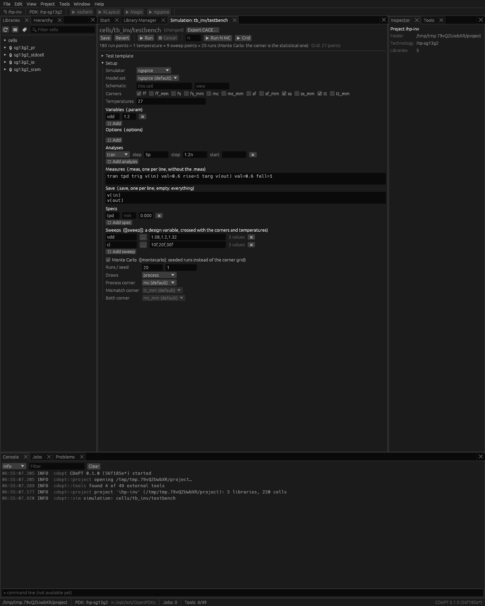

# Monte Carlo

A `[montecarlo]` table replaces the corner grid by `runs` independent, seeded points of the
technology's statistical corner. Each point is its own simulator run, queued like any other.

```toml
[montecarlo]
runs = 50
seed = 1
mode = "process"    # process | mismatch | both
```

```bash
cdept sim run cells tb_inv --view montecarlo                 # as written
cdept sim run cells tb_inv --view montecarlo --runs 50 --seed 7
cdept sim run cells tb_inv --view montecarlo --no-mc         # the corner grid instead
```

`--runs` also turns Monte Carlo on for a setup without the table; `--mode` and `--seed`
override the setup's. Points are `mc_27_r000`, `mc_27_r001`, ... (`runs` x temperatures x
sweeps). Each has a seed derived from the base seed and the run number, stored in
`result.json`: the same seed repeats a run, another seed changes it.

## From the form

Tick **Monte Carlo** in the Simulation tab's setup form to add `[montecarlo]`; unticking it
removes the table. The section has the runs and the seed, the draws (`process`, `mismatch`
or `both`) and the corner set of each kind of draw, chosen from the model set's corners
(empty: the defaults of the table below). The same text as `cdept sim run` appears under
the section when the mode cannot run, for instance when the model set has no `tt_mm`
corner set for `mismatch`. With Xyce the `mismatch` and `both` draws stay disabled until
their corner set is named, and with VACASK the form says that Monte Carlo is refused. The
line under the toolbar counts the points: temperatures x sweep points x runs.



**Run N MC** runs the number in the box next to it with the form's seed, mode and corner
sets (the file is not changed); **Grid** (shown when the run has Monte Carlo) runs the
corner x temperature x sweep grid once instead. A template that declares `[montecarlo]`
shows it as `from template <name>` with an **Override** button; your own `[montecarlo]`
replaces the template's as a whole.

## What is drawn

| mode | meaning | corner set used |
|---|---|---|
| `process` | Global process variation, one draw per parameter per circuit. | `corner`, default `mc` |
| `mismatch` | Local per-device mismatch. | `mismatch_corner`, default `tt_mm` |
| `both` | Both together. | `both_corner`, default `mc_mm`, else `corner` with `mc_mm_switch=1` |

How the PDKs provide this is in [SIMULATION.md](../SIMULATION.md) (section 5). On IHP
SG13G2 there is no PDK corner with both; the example project's `tech.toml` defines `mc_mm`
by hand and `cdept tech refresh` does not recreate it. Only MOS transistors have mismatch
there. The `mismatch` and `both` views of `tb_inv` use these modes.

## Read the statistics

`cdept sim run` prints the report after the runs; `cdept sim results cells tb_inv --view
montecarlo --stats [--bins 10] [--sigma 3]` prints it again from the stored runs:
percentiles p5/p50/p95, a histogram per measurement and the yield per spec
(runs that met the spec, the yield a normal fit predicts, and whether mean +- 3 sigma is
inside the spec).

```text
yield            spec                              pass    yield   gaussian     mean+-3s
tpd              <= 4.0000e-10                      6/6   100.0%    100.00%       inside
all specs                                           6/6   100.0%
```

## With Xyce

Xyce does process Monte Carlo (`simulator = "xyce"`); each run is one `.SAMPLING` sample
with its own `-randseed`. Mismatch and both are refused unless `mismatch_corner` or
`both_corner` names a corner set that has transistor mismatch (the IHP Xyce models have
none). The `xyce_mc` view shows the variables the IHP Xyce statistical files need. See
[Other simulators](other-simulators.md). VACASK refuses Monte Carlo.

## See also

- [setup.toml](../reference/files/setup-toml.md) (`[montecarlo]`), [Results](../reference/files/results.md)
- [Corners and sweeps](corners-and-sweeps.md), [Simulation concepts](../concepts/simulation.md)
