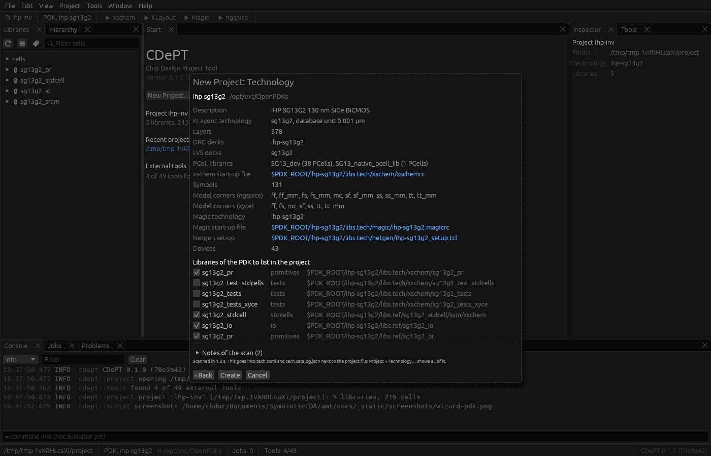

# Create a project for a PDK

This page shows four ways to start a project: from the command line for a PDK installed
on this machine, from the GUI wizard, from an existing folder of design files, and from an
IHP LibMan project. The examples use `PDK_ROOT=/opt/ext/OpenPDKs`, which holds `ihp-sg13g2`
and `sky130A`.

What a project and its files are is in [Projects](../concepts/projects.md); what the PDK
scan captures is in [Technology and the PDK](../concepts/technology.md).

## From the command line

```sh
export PDK_ROOT=/opt/ext/OpenPDKs
cdept init mychip --technology ihp-sg13g2
```

`--technology` takes a PDK name or the path of a PDK folder. CDePT looks for the PDK in
`--pdk-root`, else `$PDK_ROOT` and the usual places (`cdept pdk ls` lists them), scans
it, and writes the files:

```text
scanning /opt/ext/OpenPDKs/ihp-sg13g2 ...
created /work/mychip/cdept.toml
PDK ihp-sg13g2 in /opt/ext/OpenPDKs (environment)
pdk      commit            cb743f75aabc96e30450e9e53afc8d3c4867e5e2
         family            ihp-sg13g2
         name              ihp-sg13g2
         ...
klayout  dbu               0.001
         drc               ihp-sg13g2
         lvs               sg13g2
         tech              sg13g2
         ...
models   corner            tt
         default           ngspice
         ...
devices  count             43
         pcells            map
         ...
```

The project folder now holds:

```text
mychip/
  cdept.toml           project file: name, technology, libraries
  tech.toml            technology snapshot (about 16 KB for IHP SG13G2)
  tech.catalog.json    long lists behind it (about 1 MB)
```

The scan takes about three seconds with a debug build. `--files-only` reads files only and
does not start KLayout or xschem; it is faster, but PCells and what the `xschemrc` sets
are not found.

Where the PDK folder is recorded:

- When the environment's `PDK_ROOT` already points at the folder that holds the PDK, CDePT
  writes nothing about it (`PDK_ROOT ... (environment)` above).
- Otherwise, or when you pass `--pdk-root DIR`, it writes `pdk_root` into
  `cdept.local.toml`, which is not meant for version control, and adds that file to
  `.gitignore` if the project is in a git repository.

  ```sh
  cdept init mychip --technology ihp-sg13g2 --pdk-root /opt/ext/OpenPDKs
  ```

To name a PDK without scanning it (a machine that does not have the PDK), add
`--no-scan`. The project gets `technology` and a warning, and `tech.toml` is made later
with `cdept tech scan`.

The new `cdept.toml` has an empty `[libraries]` table. The PDK's own libraries
(`sg13g2_pr`, the standard cells) are listed from `tech.toml` without being written into
it; your libraries are added with `cdept lib` or from the GUI.

### Change the PDK of an existing project

```sh
cd mychip
cdept tech scan sky130A        # scans the PDK and replaces tech.toml
```

`cdept tech scan --print [PDK]` only prints the `tech.toml` text and needs no project.

## From the GUI

Open **File > New Project...**. The wizard has two pages.

1. **Project.** Enter the folder (the path field completes and has *Browse...*) and,
   optionally, a name; the default is the folder name. The folder is created, or, when
   it exists, `cdept.toml` is added to it. Under *Technology (PDK)* the PDKs found on this
   machine are listed with family and version. Pick one, or add another PDK folder with
   *Other folder*. *Scan files only* has the same meaning as `--files-only`. Without a
   PDK choice, *Create* makes a project with no technology; with one, *Next* scans the PDK.
2. **Technology.** The summary of the scan, a list of the PDK's libraries with a check box
   each (the libraries to list in the project; test benches and examples start
   unchecked), and the notes of the scan. *Back* returns to the first page; *Create*
   writes the files and opens the project.


*The second page of the wizard.*

The same choices are available later: *Project Settings* has an *Installed PDKs* menu that
fills in the technology and the PDK folder, and a *Rescan technology* check box that
reads the PDK again when the settings are saved. The **Technology** tab shows the
snapshot, in pages (overview, layers, layout tools, models, devices, libraries, notes).

## From an existing design folder

`cdept import` proposes a project for a folder that already has design files: its
libraries come from an `xschemrc`, from folders that hold schematics, layouts and so on,
or from an IHP LibMan project file in the folder.

```sh
cdept import old
```

```text
Project 'old' in /work/old

Libraries (2):
  [x] lay  flat   lay  (2 cells: 2 layout, from folder)
  [x] xs   flat   xs  (5 cells: 5 schematic, from folder)

Nothing written. --write makes /work/old/cdept.toml; --skip NAME and --with NAME change which libraries are listed.
```

Without `--write` nothing is written. `--toml` prints the project file the plan stands for.
`--skip NAME` leaves a library out, `--with NAME` lists a library that the plan leaves
unticked (`--with all` ticks every one), `--into DIR` puts `cdept.toml` into another
folder while the libraries stay where they are, and `--add` adds the libraries to the
project the folder already has. An `xschemrc` is evaluated with the xschem helper unless
`--no-helper` is given.

```sh
cdept import old --write
```

```text
Wrote /work/old/cdept.toml (2 libraries).
```

`import` does not choose a PDK. Name it afterwards, which scans it too:

```sh
cd old
cdept tech scan ihp-sg13g2
```

## From a LibMan project

IHP LibMan keeps its libraries in a project file of `define("name", "path/*");` lines.
`cdept import` reads such a file when it is in the folder, or give it with
`--libman FILE`. In the other direction, write the project's libraries as a LibMan file:

```sh
cdept -p old libman export
```

```text
# Library definition file for LibMan / DOOR
# Written by CDePT for project old. Rewritten every time: do not edit.

define("lay", "/work/old/lay/*");
define("xs", "/work/old/xs/*");
```

`cdept libman show FILE` prints what a LibMan project file defines, and `cdept libman open`
starts LibMan (`libman` or `door` on `PATH`) on the project's libraries. Starting LibMan
is not exercised in the test suite of this version.

## Check the result

```sh
cd mychip
cdept info
```

```text
project      mychip
file         /work/mychip/cdept.toml
PDK          ihp-sg13g2  (project)
PDK_ROOT     /opt/ext/OpenPDKs  (environment)
snapshot     tech.toml  (PDK ihp-sg13g2)
xschem rc    /opt/ext/OpenPDKs/ihp-sg13g2/libs.tech/xschem/xschemrc
libraries    4 (0 with errors)
```

`PDK` and `PDK_ROOT` show where each value comes from (`project`, `cdept.local.toml`,
`environment`). A line `snapshot ... (not used: made for PDK ...)` means `tech.toml`
belongs to another PDK.

```sh
cdept tech show                # summary of every section
cdept tech show netgen         # one section as it is in tech.toml
cdept tech show --catalog netgen    # the section's lists, as JSON
cdept tech notes               # what the scan could not find or had to guess
```

```text
$ cdept tech show netgen
[netgen]
setup = "$PDK_ROOT/ihp-sg13g2/libs.tech/netgen/ihp-sg13g2_setup.tcl"
environment = ["NETGEN_COLUMNS"]

$ cdept tech notes
- devices: 2 device(s) netlist as a model no model library defines (inductor, inductor3)
- libraries: the PDK has two libraries named 'sg13g2_pr'; a project lists $PDK_ROOT/ihp-sg13g2/libs.tech/xschem/sg13g2_pr and not $PDK_ROOT/ihp-sg13g2/libs.ref/sg13g2_pr (a library cannot have several folders yet)
```

Notes are not errors. They say what the project does with a PDK feature it cannot
represent yet.

`cdept ls` lists the libraries, including those of the PDK:

```text
sg13g2_pr  /opt/ext/OpenPDKs/ihp-sg13g2/libs.tech/xschem/sg13g2_pr  [flat, read-only]
  annotate_bip_params              symbol
  ...
```

### Keep the snapshot current

When the PDK is updated, `cdept info` warns that `tech.toml` is out of date. Run

```sh
cdept tech refresh --dry-run   # what would change
cdept tech refresh             # replace tech.toml and tech.catalog.json
```

Hand edits of `tech.toml` are replaced by a refresh; see
[Hand edits and refresh](../concepts/technology.md#hand-edits-and-refresh).

## See also

- [Technology and the PDK](../concepts/technology.md)
- [tech.toml and tech.catalog.json](../reference/files/tech-toml.md)
- [cdept.toml](../reference/files/cdept-toml.md) and
  [cdept.local.toml](../reference/files/cdept-local-toml.md)
- [Projects](../concepts/projects.md)
- [Run DRC, LVS and extraction](lvs-drc.md)
- [TECH.md](../TECH.md): scan design and command reference
