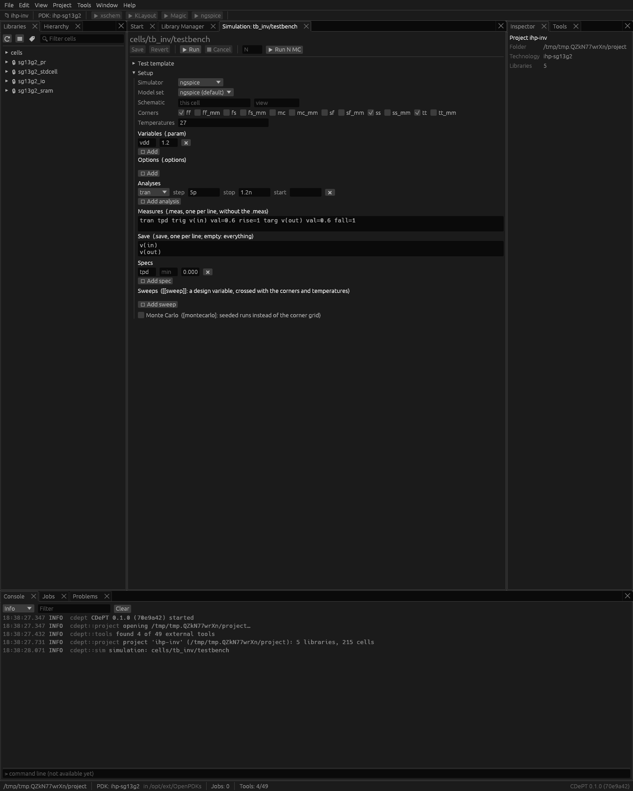

# Run a testbench

A testbench is a view with a `setup.toml`. This page runs the one in `examples/ihp-inv`
and reads the result.

## Prerequisites

The tools are found through environment variables or `PATH` ([Environment](../reference/environment.md)).
For the IHP example:

```bash
export PDK_ROOT=/opt/ext/OpenPDKs
export CDEPT_NGSPICE=/opt/ext/OpenLane/bin/ngspice   # or ngspice on PATH
export CDEPT_XSCHEM=target/debug/cdept-xschem         # the xschem helper
```

## Run it

```bash
cd examples/ihp-inv
cdept sim run cells tb_inv --view testbench
```

```text
point  result           tpd
tt_27  PASS      4.5138e-11
ff_27  PASS      3.8640e-11
ss_27  PASS      5.3923e-11

3 run(s): 3 pass, 0 fail, 0 error
```

`--view` is optional when the cell has a single testbench. `--corner ss` runs only that
corner instead of the setup's. `-j N` limits how many simulators run at once. The command
exits non-zero if a run errors or a spec fails or is missing, so it can gate a script.

## Look at what was run

```bash
cdept sim deck cells tb_inv --view testbench     # the first point's deck, no simulation
ls simulations/cells/tb_inv/testbench/tt_27      # deck.sp out.raw out.log result.json ...
cdept sim results cells tb_inv --view testbench  # the latest run of each point
cdept sim results cells tb_inv --view testbench --all   # every stored run
```

`out.log` is the simulator's output and `job.log` the job's. The folder layout and the
record are described in [Results](../reference/files/results.md).

## Write one

A minimal `setup.toml` in a new view `tb_inv/mytest`:

```toml
corners = ["tt"]
temperatures = [27, 85]
measures = ["tran tpd trig v(in) val=0.6 rise=1 targ v(out) val=0.6 fall=1"]
[[analysis]]
kind = "tran"
step = "5p"
stop = "1.2n"
[[spec]]
name = "tpd"
max = 3e-10
```

For a ready-made test, start from a template instead:
`cdept sim new cells tb_inv mytest --template tran_delay` ([Custom test template](custom-test-template.md)),
or in the GUI with [New Testbench](#a-new-testbench-from-the-window).
Errors in the file (unknown key, a spec without bounds, a bad expression) are reported when
the setup loads, before anything runs.

## A new testbench from the window

**Tools > New Testbench…** (also **+ Testbench** in the Library Manager's toolbar, a cell's
context menu, and the button of the empty Simulation tab) asks for:

- the library, the cell of the testbench (an existing one or a new name) and the view name
  (it follows the template until you type one);
- the test template, with its parameters (an empty field is the default);
- the schematic to simulate. A cell that has a schematic netlists its own. Otherwise:
  *a starter schematic around a device under test* (a cell with a symbol; the same as
  `cdept sim new --dut`), *the schematic of another cell* (`schematic =` in `setup.toml`),
  *a new empty schematic* to draw the testbench in, or none yet.

With a cell that has a symbol selected, the dialog proposes `tb_<cell>` with that cell as
the device under test. **Create** writes the view and opens it in the Simulation tab, where
the template and its parameters can be changed under *Test template*. Read the starter
schematic before trusting it: pins are matched to the template's nets by name.

A schematic's sources often use design variables (`{vdd}`, `{cl}`). When another testbench
of the library simulates the same schematic, the new one gets that testbench's variables
(those it does not set itself); the Console names the source. Check the ones that differ
between measurements, such as which source carries the AC signal.

## In the GUI

The Simulation tab shows the setup as a form, runs through the same job queue and lists the
points with PASS/FAIL ([GUI guide](../guide/gui.md)).


*The Simulation tab with the setup form of tb_inv.*

## See also

- [setup.toml](../reference/files/setup-toml.md), [Results](../reference/files/results.md)
- [Corners and sweeps](corners-and-sweeps.md), [Simulation concepts](../concepts/simulation.md)
- [SIMULATION.md](../SIMULATION.md), [NGSPICE.md](../NGSPICE.md)
