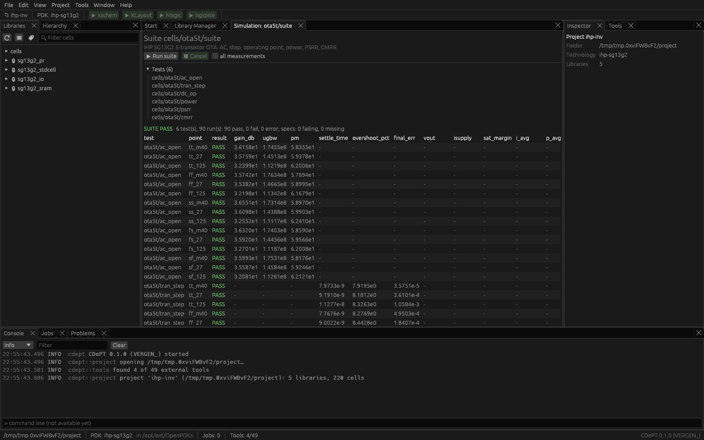

# Run a suite of tests

A suite runs several testbenches together and gives one table and one verdict. This is the
way to characterise a block (delay, DC transfer, power, AC response) with one command.

## Create a suite

Add a view to a cell, for example `libs/cells/tb_inv/suite/suite.toml`:

```toml
description = "IHP SG13G2 inverter: delay, DC transfer, power and AC response"
corners = ["tt", "ff", "ss"]     # optional: replaces every test's corners
temperatures = [27]              # optional: replaces every test's temperatures

[[test]]
view = "tran_delay"              # a view of this cell

[[test]]
view = "tb_inv_ac/ac_response"   # cell/view of this library; or library/cell/view
```

Each test is an ordinary testbench view, usually made from a
[template](custom-test-template.md). `name = "ac"` gives a test a label in the table.

## Run it

```bash
cdept sim suite cells tb_inv
```

```text
test                   point  result           tpd  ...
tb_inv/tran_delay      tt_27  PASS      4.3617e-11  ...
...
suite cells/tb_inv/suite: 4 test(s), 12 run(s): 12 pass, 0 fail, 0 error; specs: 0 failing, 0 missing
SUITE PASS
```

Options: `--view V` when the cell has several suites, `-j N` for the number of simulators at
once, `--all-columns` for every measurement instead of the ones that have a spec, `--json`
for the report as JSON, `--no-store` to keep nothing.

The exit status is non-zero when a test cannot run (an `ERROR` row: not a testbench, a
template or net error, simulator missing), a run fails or errors, or a spec fails or is
missing. A failing test does not stop the others.

## The OTA example

`examples/ihp-inv/libs/cells/ota5t/suite` runs the six tests of a 5-transistor OTA (open-loop
AC, unity-gain step, operating point, power, PSRR, CMRR) over five corners and three
temperatures, 90 runs:

```bash
cdept sim suite cells ota5t
```

```text
test             point   result       gain_db          ugbw            pm   settle_time  ...
ota5t/ac_open    tt_27   PASS        3.5759e1      1.4513e8      5.9378e1             -  ...
ota5t/tran_step  tt_27   PASS               -             -             -     9.1910e-9  ...
...
suite cells/ota5t/suite: 6 test(s), 90 run(s): 90 pass, 0 fail, 0 error; specs: 0 failing, 0 missing
SUITE PASS
```

The same in the Simulation tab (double-click the `suite` view of `ota5t`, **Run suite**):



## Stored report

The runs of each test are stored as usual. The suite adds
`simulations/cells/tb_inv/suite/suite.json` and a row in `suite_runs` of `results.db`
([Results](../reference/files/results.md)). The Simulation tab shows the last stored report
when it opens a suite view and has a **Run suite** button.

## See also

- [suite.toml](../reference/files/suite-toml.md), [Test template](../reference/files/test-template.md)
- [TESTS.md](../TESTS.md)
