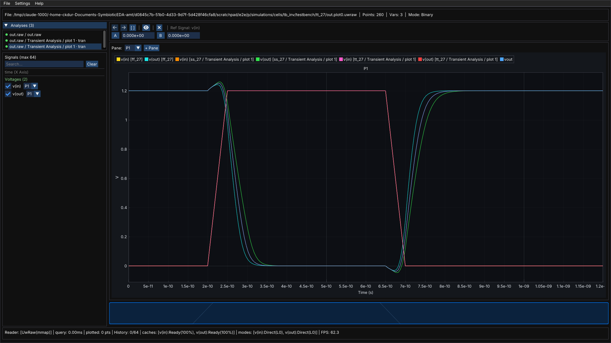

# View waveforms

CDePT has no waveform viewer of its own. The viewer is **UberWave**, Symbiotic EDA's program
(C++ with Dear ImGui and ImPlot, built for very large ngspice raw files and Spectre PSF
results). It is **part of the `cdept` executable**: its window runs on a thread of the cdept
process, next to the main window, and CDePT talks to it with plain function calls (no helper
process, no socket, no JSON for data; the calculator hands over its `f64` arrays as they are).
When UberWave was not built into your `cdept`, CDePT falls back to starting `UberWaveViewer`
as a separate process (see [the fallback](#the-fallback-uberwaveviewer-as-a-process)).

What stays in CDePT are the numbers: measurements, the [calculator](../CALC.md)
(`cdept calc`, `[[output]]` in `setup.toml`) and the spec table of the Simulation tab. UberWave
is for looking at the curves.


*Made with* `cdept wave cells tb_inv --view testbench --family --calc 'v("out") * 0.5' --name 'half out' --screenshot out.png`.

## Which UberWave you have

`cdept tools` shows it in the UberWave row:

| row says | meaning |
| --- | --- |
| `built in (embedded)  UberWaveViewer 0.1.0 ipc 1` | UberWave is in this executable; `cdept wave` opens its window in this process |
| `process: <version>  (<path>)` | not built in; the separate program `UberWaveViewer` was found (the fallback) |
| `not available` | neither: build UberWave in, or build the program, as below |

The backend is chosen in this order, the first that is set wins:

1. `cdept wave --backend embedded|process`;
2. the environment variable `CDEPT_UBERWAVE_BACKEND` (`embedded` or `process`);
3. `[wave] backend = "embedded" | "process"` in `cdept.toml`;
4. the default: `embedded` when it is built in, else `process`.

Asking for `embedded` in a cdept that does not have it is an error that says how to build it in
(it does not silently use the process).

## Build UberWave into cdept (Linux)

UberWave lives in its own repository (`uberwave`, branch `ipc-multifile` until it is merged).
`cdept-uberwave`, a crate of this workspace, builds its library `uberwave_embed` with CMake
and links it into `cdept`. Point it at the source and build as usual:

```bash
sudo apt install build-essential cmake libgl1-mesa-dev libgtk-3-dev   # compiler, CMake, OpenGL and GTK 3 development files
export UBERWAVE_SRC=~/uberwave          # the root of the uberwave repository
cargo build                              # or: cargo install --path cdept
cdept tools | grep UberWave              # built in (embedded)
```

- `UBERWAVE_SRC` is the root of the repository (the `wp5-viewer` folder is accepted too). Without
  it the build looks for a sibling `../uberwave` of the CDePT repository that has
  `wp5-viewer/shim/uberwave_shim.h`.
- The first build fetches GLFW, Dear ImGui, ImPlot, NFD-Extended and nlohmann/json with CMake
  (it needs the network and `git`) and compiles them under `target/`; it takes about a minute.
  Later builds only redo what changed in the UberWave source.
- No network, or the libraries are fetched already: `UBERWAVE_OFFLINE=1` stops CMake from
  fetching and `UBERWAVE_DEPS_DIR` names a FetchContent folder that has the sources (the
  `_deps` of an earlier build). `UBERWAVE_LIB_DIR=<cmake build dir>` links an existing CMake
  build of the source (one that built the target `uberwave_embed_probe`) and builds nothing.
- Linux only, X11 or Wayland. UberWave's own `Docs/Embedding.md` describes the C API and the
  threading.

If anything is missing (no source, no `cmake`, no OpenGL or GTK 3 files, no network) the build does
**not** fail: it prints a `cargo:warning` that says why and builds a stub; `cdept` then uses the
process fallback. That is also what a build without `UBERWAVE_SRC` gives, for example the public CI.

### How the window lives next to cdept

The viewer thread owns its own window, its own GLFW and display connection and its own OpenGL
context; cdept's window (egui on winit) keeps running meanwhile. Checked with the GUI on Wayland
and on X11, with the viewer on either backend. Without `libdecor` a Wayland viewer window has
no title bar, which is cosmetic. To force a backend for the viewer window set
`UBERWAVE_GLFW_PLATFORM=x11` (or `wayland`).

- Only one viewer window exists per process. The GUI reuses it for every open of every project
  run (the files are replaced by the ones asked for); after you close it, the next open starts a
  new one.
- `cdept wave` opens the window and **waits until you close it**, then exits (the viewer's thread
  belongs to the process). The GUI never waits: opens run in a background thread.
- Closing the viewer window does not close cdept.
- `cdept wave ... --screenshot out.png` loads everything into a hidden 1280x720 window, saves it
  and exits (no window appears): for documentation and checks.

## Open a run point

From the GUI: run a testbench in the Simulation tab, and press **Open in UberWave** on the
point you want, in the Results list. A problem (no viewer, no raw file) goes to the log panel with
how to fix it.

From the shell:

```bash
cdept sim run cells tb_inv --view testbench
cdept wave cells tb_inv --point tt_27           # the raw file of one run point (the window of the run is reused)
cdept wave cells tb_inv --list                  # the points and their raw files
cdept wave simulations/cells/tb_inv/testbench/tt_27/out.raw      # any raw file
cdept wave out.raw --analysis ac                # preselect an analysis
cdept wave --list out.raw                       # analyses and signal counts, no viewer
```

- `--view` names the testbench view; it can be left out when only one view of the cell has
  results. `--point` can be left out when there is only one run point; with several, the error
  lists them.
- When a raw file has several analyses (an operating point, then a transient, for example),
  CDePT preselects the transient one with `--analysis tran`. `--analysis` takes `tran`, `ac`,
  `dc`, `noise` or `op`, or the analysis name as the simulator wrote it. For a Spectre PSF
  folder the name goes to UberWave unchanged.
- With the embedded UberWave `cdept wave` stays until the window is closed. The process fallback
  starts the viewer detached, with the run point's folder as its working folder, and it keeps
  running after `cdept` exits.
- Several points need `--point`, `--points` or `--family`; the error lists them.

## Sweeps, corners and Monte Carlo: families

A sweep, a corner grid or a Monte Carlo run has one raw file per point. They open together in one
window (the embedded UberWave, or a process viewer that has IPC), each file tagged with its point
name (`tt_27`, `mc_27_r003`):

```bash
cdept wave cells tb_inv --view testbench --family           # every point of the view
cdept wave cells tb_inv --view testbench --points tt_27,ss_27
```

In the GUI, **Open family in UberWave** in the Results area of the Simulation tab does the
same. Opening again (a point, a family, the button) reuses the open window and replaces its
session by the files asked for.

### What is plotted when it opens

A file that is opened this way plots nothing until it is told to, so after opening CDePT shows
signals for each file (tag = point name), all in one pane. By default the signals are:

1. the nodes the testbench `save`s in its `setup.toml`, if the raw file has them;
2. else the signals its `measures` and `[[output]]` expressions use;
3. else the first four voltages that are not the time or frequency axis, ground (`0`, `gnd`)
   or a supply (`vdd`, `vss`, ...).

```bash
cdept wave cells tb_inv --view testbench --family --show out,in   # these signals of every point
cdept wave cells tb_inv --view testbench --family --no-show       # open, plot nothing
```

`--show` takes a comma separated list (`v(out)` or just `out`, `i(vdd)`; no `tag:`, CDePT adds
the point name). A name a file does not have is a note. A freshly started viewer is waited for
while it loads the files (up to a minute); **Open family in UberWave** and **Open in UberWave**
in the GUI use the default and do not block the window.


## Calculator traces

The [calculator](../CALC.md) can feed the viewer: an expression is evaluated by CDePT on the raw
file of a point and the waveform it gives is sent as a new trace, next to the signals of the
files.

```bash
cdept wave cells tb_inv --view testbench --point tt_27 --calc 'db20(v("out"))' --name out_db
cdept wave cells tb_inv --view testbench --family --calc 'v("out") / v("in")'
cdept wave cells tb_inv --view testbench --family --calc 'max(v("out"))'   # scalars: a table
```

- With one point and `--name`, the trace is called as given; otherwise `<name or expression> @
  <point>`, one trace per point. Sending the same name again replaces the trace.
- A complex waveform (an AC result) is sent as two traces, `<name> (mag dB)` (20 log10 of the
  magnitude) and `<name> (phase)` (degrees, unwrapped).
- Points whose value is not finite (a `db20` of zero) are left out of a trace.
- A scalar result is printed, one line per point (`point<TAB>value`), and nothing is sent. A
  calculator error is reported per point with its position in the expression.
- The viewer is started on the chosen points when none is open yet; a running one is left as it
  is.
- `--analysis` limits the expression to one analysis of the raw file, as `cdept calc --plot`.
- Names are written in quotes, `v("out")`. `v(out)` is accepted here too (tried when the
  expression as written fails); when an expression still fails the error says
  `hint: write node names in quotes: v("out")` (see [the calculator](../CALC.md)).
- A viewer that is started for the push plots the default signals first (`--show`,
  `--no-show` as above); a running one is left as it is.
- The embedded UberWave gets the points as they are, however many (no thinning). The process
  fallback sends a trace with more than 200000 points as a min/max envelope of at most half of
  them (first and last point and the extrema are kept), named `<name> (decimated)`, with a note;
  `--no-decimate` sends it whole and `[wave] max_points` in `cdept.toml` changes the limit (`0`:
  never). A socket carries the data as JSON: the viewer parses 10 million points in about ten
  seconds, with the window stopped meanwhile.



In the GUI, the Results area of the Simulation tab has an expression line with a choice of
points (all, or one) and **Send**. Scalars and errors show under the line; typing the start of
a function name offers matching names as buttons. The evaluation runs in the background.

## The fallback: UberWaveViewer as a process

Without the built-in UberWave CDePT starts the separate program `UberWaveViewer`. Build it from
the `uberwave` repository: `cmake -B build -DCMAKE_BUILD_TYPE=Release && cmake --build build
--target UberWaveViewer`; the program is `build/wp5-viewer/UberWaveViewer`. The process is also
used when you ask for it (`--backend process`, `CDEPT_UBERWAVE_BACKEND=process`, `[wave] backend =
"process"`).

CDePT finds the program, in this order:

1. `$CDEPT_UBERWAVE`, the path of the program;
2. `UberWaveViewer` (or `uberwave`) on `PATH`;
3. a build next to the project or next to the CDePT repository, as a convenience for
   developers: `../uberwave/build/wp5-viewer/UberWaveViewer`, or in another `build*` folder.

The version shown by `cdept tools` is the first line of `UberWaveViewer --version` (for example
`UberWaveViewer 0.1.0 ipc 1`); `ipc 1` means the viewer has the control channel. Families, the
reuse of a running viewer and the calculator traces need it (the branch `ipc-multifile` of the
`uberwave` repository, until it is merged). With an older viewer CDePT keeps working as before: it
opens the first file, says so and lists the other files (**File > Import** adds them);
calculator traces cannot be sent to it, scalar results are still printed.

What differs from the built-in viewer:

- The viewer is a process of its own, started detached; `cdept wave` returns at once and the
  window stays after `cdept` exits.
- CDePT starts `UberWaveViewer --ipc <socket> --tag ... FILE...` with the socket named after the
  project and the run (`$XDG_RUNTIME_DIR/cdept-uw-<hash>.sock`, else the temporary folder).
  Opening the same run again finds that viewer and sends `open` and `import` to it; another run,
  or another project, gets its own viewer. A socket left by a viewer that died is replaced.
- Calculator traces travel as JSON and are thinned above `[wave] max_points` (see above).
- `--screenshot` is not available (it needs the embedded UberWave).

The protocol (UberWave's own, version 1) is one JSON object per line over the Unix socket.
CDePT implements the client in `libcdept::wave::ipc` (`hello`, `open`, `import`,
`list_files`, `list_signals`, `show`, `add_trace`, `get_cursors`, `set_cursors`, `quit`, ...);
`cdept-gui/scripts/fake-uberwave-ipc.py` is a stand-in server for tests. Both backends go
through one interface (`libcdept::wave::backend::ViewerOps`), so `cdept wave` and the GUI do not
care which one runs.

## See also

- [Run a testbench](run-testbench.md)
- [Calculator](../CALC.md) for the numbers: `cdept calc`, `[[output]]`
- [Tools](../tools.md)
