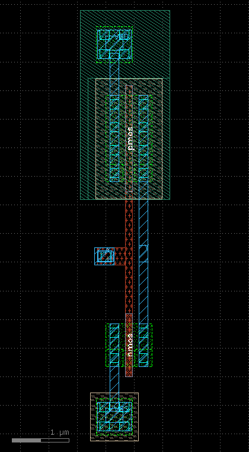

# Inverter 6: draw the layout

<!-- Made from cdept-gui/tutorials/inv-layout.toml by `cdept tutorial inv-layout --print`. Edit that file, not this one. -->

You turn the inverter's schematic into a layout in the embedded KLayout: you generate
the two transistors, place the contacts to the substrate and the n-well, route the
gates, the output and the supplies, add the pins and check that every net is whole.

About 45 minutes. To be guided through it inside CDePT:

```sh
cdept tutorial inv-layout
```

## Before you start

- [Inverter 2](inv-schematic.md): the schematic of inv. Or let the guide make the
  starting project.
- KLayout built for CDePT (`cdept-klayout/build.sh`) and the xschem helper.

## 1. Get the project

Either let the guide make the starting project (library "work" with the inverter's
schematic), or open your own project from the earlier inverter tutorials and press
Continue. A layout of inv must not exist yet.

## 2. Open the schematic of inv

In the Libraries panel, open "work", then "inv", and double-click "schematic". The
layout is made from it.

## 3. Generate the layout

In the menu bar: Cell > Generate / Update Layout.

CDePT makes the view "layout" of inv, opens it, and places one PDK cell for each
transistor with the width and length of the schematic: a "pmos" and an "nmos" of the
library SG13_dev. It also places the four pins in a column on the left. Wait until
you see them.

## 4. Look around

This is a layout: each colour is a mask layer, seen from above. Red is polysilicon
(GatPoly, the gates), green is the active area (Activ), blue is the first metal
(Metal1), and the large hatched area around the upper transistor is the n-well.

- Mouse wheel: zoom around the pointer. F2: fit.
- The line under the picture shows the pointer's position in micrometres.
- The Layers list on the right chooses what you draw on.

This is what you are going to make: the two gates joined (with a contact for A), the
two drains joined (Y), each source tied to its supply, and a contact to the substrate
below and to the n-well above.

All coordinates below are micrometres. A box is given as left, bottom, right, top.



## 5. Line up the gates

Move the PMOS so that its gate is straight above the NMOS gate:

- choose Select in the toolbar and click the PMOS (the upper device);
- press Q (Properties);
- set x to 0 and y to 3.41, then press OK.

Typing positions is the exact way to place a part: dragging gets you near, Properties
gets you there.

## 6. A contact to the substrate

The NMOS sits in the p-type substrate, which must be connected to VSS, or the rule
LU.b fails and the transistor's bulk floats. A contact from the active area to Metal1
does that.

Layout > Place Library Cell. Choose the library SG13_dev, type via_stack in "Filter
cells" and click the cell, then set its parameters:

    b_layer = Activ
    t_layer = Metal1
    vn_columns = 2
    vn_rows = 2

Press Place and click somewhere free below the NMOS. Then choose Select, click what
you placed, press Q and set x = 0.15, y = -0.7.

Do not use the PDK's cells ptap1 and ntap1 here: the LVS deck reads each of them as a
device, which your schematic does not have.

## 7. A contact to the n-well

The PMOS sits in an n-well, which must be connected to VDD. Place the same via_stack
again (Activ to Metal1, 2 by 2), above the PMOS, and set x = 0.15, y = 5.8.

## 8. The contact of the gates

The gates are polysilicon; the pin A will be on Metal1. Place a third via_stack with:

    b_layer = GatPoly
    t_layer = Metal1
    vn_columns = 1
    vn_rows = 1

Set it to x = 0, y = 2.1: between the two transistors, left of the gates.

## 9. How to draw a box exactly

You will now draw boxes. For each:

- pick the layer in the Layers list (type its name in "Find a layer");
- choose Box in the toolbar;
- click one corner, then the opposite corner. The line under the picture shows where
  you are.

Corners snap to the 5 nm manufacturing grid. To hit a coordinate, one pixel must be
smaller than that: zoom in with the wheel on each corner, also between the two
clicks. If you prefer, draw roughly, then select the box, press Q and type its edges.
u is not undo here: use Ctrl+Z.

## 10. Join the gates

On GatPoly.drawing, draw two boxes. The first joins the two gates, the second leads to
the contact:

    0.34, 1.1, 0.47, 3.23
    0.15, 1.95, 0.34, 2.25

The first is exactly as wide as the gates (0.13 µm, the shortest channel, and the
smallest width of polysilicon, rule Gat.a).

## 11. The implant and the n-well

Two boxes say what the contacts are. On pSD.drawing (the p+ implant) around the lower
contact, which makes it a contact to the p substrate:

    -0.27, -1.12, 0.57, -0.28

On NWell.drawing, one well around the PMOS and the upper contact:

    -0.45, 3.1, 1.12, 6.4

The upper contact has no pSD, so it is n+ in the n-well: a contact to the well.

## 12. Route in Metal1

On Metal1.drawing, four boxes:

    -0.2, 1.95, 0.15, 2.25
    0.58, 0.92, 0.74, 3.41
    0.07, -0.6, 0.23, 0.18
    0.07, 4.91, 0.23, 5.65

- The first is the pad of A: the contact's own metal is below the smallest area a
  Metal1 shape may have.
- The second is the output Y, from drain to drain.
- The third ties the NMOS source to the substrate contact (VSS).
- The fourth ties the PMOS source to the well contact (VDD).

Metal1 is at least 0.16 µm wide (rule M1.a) and 0.18 µm apart (M1.b). The two supply
straps end well inside the metal of the contacts: a strap that only touches it, or
overlaps it in part, breaks one of these rules.

## 13. Move the pins onto the wires

Pins tell the checks which wire is which net. The generated ones are in a column far
left. Open Layout > Pins Panel and press Delete for all four.

Then, for each pin: choose Metal1.drawing as the current layer; in the panel choose
the name and the direction under "New pin", press Draw, and draw a box on the metal
(inside it, rule Pin.e):

    A     input     -0.15, 2.0, 0.1, 2.2
    Y     output    0.58, 2.0, 0.74, 2.3
    VSS   inout     0.0, -0.8, 0.3, -0.55
    VDD   inout     0.0, 5.7, 0.3, 5.95

Your boxes need not match these exactly: each must lie on its own net's metal. The
panel opens at the bottom and takes room from the picture: press F2 to fit again.

## 14. Save

Press Ctrl+S, or the Save button. The star after the tab's name goes away.

## 15. Check the nets

Layout > Update Connectivity. CDePT extracts what your shapes really connect, with the
PDK's own rules, and compares it with the schematic.

You want "4 ok, 0 open, 0 shorted". A net that is open is drawn with flylines (thin
lines) between its pieces: they show what still has to be connected. Click a net in
the panel to see it. Fix the shapes and the lines follow your edits.

The panels at the bottom (Pins, Nets, Link) take room from the picture: press their
"Close" buttons when you have read them and need the picture back.

## 16. What you have

The layout of the inverter, with every net as the schematic says. Save it (Ctrl+S) if
you changed anything.

A connected layout is not yet a correct one. The next tutorial, "Inverter 7: DRC and
LVS", runs the foundry's rules and compares the extracted circuit, sizes included,
with the schematic.


