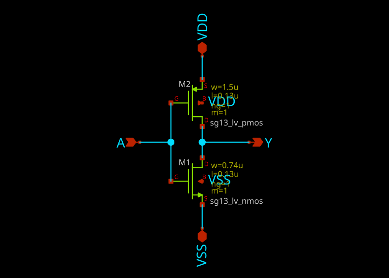

# Inverter 2: draw the schematic

<!-- Made from cdept-gui/tutorials/inv-schematic.toml by `cdept tutorial inv-schematic --print`. Edit that file, not this one. -->

You draw a CMOS inverter in the embedded xschem with the PDK's transistors, size
them, add its pins, wire it up and write its netlist. The guide checks the circuit
itself, so you may arrange the drawing as you like.

About 20 minutes. To be guided through it inside CDePT:

```sh
cdept tutorial inv-schematic
```

## Before you start

- [Inverter 1](inv-library.md), or let the guide make the starting project.
- CDePT built with the xschem helper (`cargo build -p cdept-xschem`).

## 1. Get the project

Either let the guide make the starting project (a library "work" with an empty cell
"inv"), or open your own project from "Inverter 1" and press Continue.

## 2. Open the schematic of inv

In the Libraries panel on the left, open "work", then "inv", and double-click
"schematic".

## 3. Moving around in xschem

The drawing, its menus and its keys are xschem's own. Keys go to xschem while the
pointer is over the drawing.

- Mouse wheel: zoom. f: fit the drawing in the window.
- Drag with the middle button: pan.
- Escape: stop what you are doing (placing, wiring).
- u: undo. Shift+U: redo.
- Click selects, Delete removes the selection.

This is the circuit you are going to draw:



## 4. Place the PMOS

Move the pointer over the drawing and press Insert (or Shift+I, or Tools > Insert
symbol). CDePT's symbol picker opens.

Choose the library sg13g2_pr, the cell sg13_lv_pmos (the list scrolls), the view
"symbol", and press "Insert". The symbol follows the pointer: click where it goes,
above the middle.

sg13_lv_pmos is the PDK's low-voltage (1.2 V) PMOS.

The guide checks the schematic `work/inv/schematic`:

| Part | Symbol | Values | Pins on nets |
|---|---|---|---|
| the PMOS | `sg13_lv_pmos` |  |  |

## 5. Place the NMOS

The same way, place sg13_lv_nmos below the PMOS.

If you placed something wrong: select it and press Delete, or press u to undo. To
move a symbol, select it and press m. Shift+R rotates and Shift+F mirrors what you
are moving.

The guide checks the schematic `work/inv/schematic`:

| Part | Symbol | Values | Pins on nets |
|---|---|---|---|
| the PMOS | `sg13_lv_pmos` |  |  |
| the NMOS | `sg13_lv_nmos` |  |  |

## 6. Size the transistors

A new transistor is 0.15 µm wide. Click one transistor to select it and press q: the
dialog shows its attributes. Change w, then press OK.

- PMOS: w=1.5u
- NMOS: w=0.74u

Leave l=0.13u, the shortest channel of this device. The PMOS is about twice as wide
because holes move more slowly than electrons: with that the two pull about equally
hard, and the inverter switches near half the supply.

ng is the number of gate fingers and m the number of copies; both stay 1.

The guide checks the schematic `work/inv/schematic`:

| Part | Symbol | Values | Pins on nets |
|---|---|---|---|
| the PMOS | `sg13_lv_pmos` | `l=0.13u` `w=1.5u` |  |
| the NMOS | `sg13_lv_nmos` | `l=0.13u` `w=0.74u` |  |

## 7. Add the four pins

Pins are how the cell connects to the outside: they become the pins of its symbol and
of its netlist.

- Ctrl+P places an input pin. Put it left of the transistors.
- Ctrl+Shift+P places an output pin. Put it on the right.
- VDD and VSS are in-out pins: press Insert, choose "xschem devices" in the
  picker's Library column, then iopin. Place one above and one below. Shift+R turns a
  pin while you place it.

Then give each its name: select a pin, press q, set lab= and press OK. The names are
A, Y, VDD and VSS, in capitals.

The guide checks the schematic `work/inv/schematic`:

| Part | Symbol | Values | Pins on nets |
|---|---|---|---|
| the input pin A | `ipin` | `lab=A` |  |
| the output pin Y | `opin` | `lab=Y` |  |
| the supply pin VDD | `iopin` | `lab=VDD` |  |
| the ground pin VSS | `iopin` | `lab=VSS` |  |

## 8. Wire it up

To draw a wire, put the pointer on the first end, press w, move to the other end and
click. Wires snap to the grid; their ends must lie on a pin or on another wire. A
dot marks where wires join.

Connect:

- both gates to the pin A;
- both drains (the middle, where the two transistors meet) to the pin Y;
- the PMOS source (top) to VDD, and the NMOS source (bottom) to VSS.

A transistor has a fourth pin, the bulk, on the middle of its right side. Wire the
PMOS bulk to VDD and the NMOS bulk to VSS. An unconnected bulk is a common mistake
that simulation does not always show.

The list below says what is still missing. A net takes its name from the pin on it,
so "pin G should be on A" means the gate does not reach pin A yet.

Instead of a long wire you may use a label: Alt+L places one, and two labels (or a
label and a pin) with the same name are connected.


The guide checks the schematic `work/inv/schematic`:

| Part | Symbol | Values | Pins on nets |
|---|---|---|---|
| the PMOS | `sg13_lv_pmos` | `l=0.13u` `w=1.5u` | `B=VDD` `D=Y` `G=A` `S=VDD` |
| the NMOS | `sg13_lv_nmos` | `l=0.13u` `w=0.74u` | `B=VSS` `D=Y` `G=A` `S=VSS` |
| the input pin A | `ipin` | `lab=A` |  |
| the output pin Y | `opin` | `lab=Y` |  |
| the supply pin VDD | `iopin` | `lab=VDD` |  |
| the ground pin VSS | `iopin` | `lab=VSS` |  |

## 9. Save

Press Ctrl+S with the pointer over the drawing. xschem asks "save file?": answer
Yes. The star after the tab's name goes away.

CDePT never saves behind your back: closing a changed tab asks first.

The guide checks the schematic `work/inv/schematic`:

| Part | Symbol | Values | Pins on nets |
|---|---|---|---|
| the PMOS | `sg13_lv_pmos` | `l=0.13u` `w=1.5u` | `B=VDD` `D=Y` `G=A` `S=VDD` |
| the NMOS | `sg13_lv_nmos` | `l=0.13u` `w=0.74u` | `B=VSS` `D=Y` `G=A` `S=VSS` |
| the input pin A | `ipin` | `lab=A` |  |
| the output pin Y | `opin` | `lab=Y` |  |
| the supply pin VDD | `iopin` | `lab=VDD` |  |
| the ground pin VSS | `iopin` | `lab=VSS` |  |

## 10. Write the netlist

A netlist is the circuit as text: what the simulator and the layout checks read.

In the menu bar, open Cell > Netlist to View > SPICE.

## 11. Read the netlist

The cell inv has a new view, "netlist". Open it from the Libraries panel, or read the
file libs/work/inv/netlist/.

You should find .subckt inv A Y VDD VSS and two lines starting with XM:

    XM2 Y A VDD VDD sg13_lv_pmos w=1.5u l=0.13u ng=1 m=1

Each line is a device: its name, the nets on its pins in the order drain, gate,
source, bulk, then the model and the sizes. Your instance names may differ, and drain
and source may be the other way round: a MOSFET is symmetrical.

If a line has a net called net1 or similar, a wire is not where you think it is.

Next: "Inverter 3: the symbol and a testbench".
