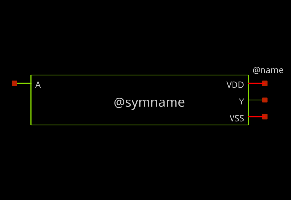
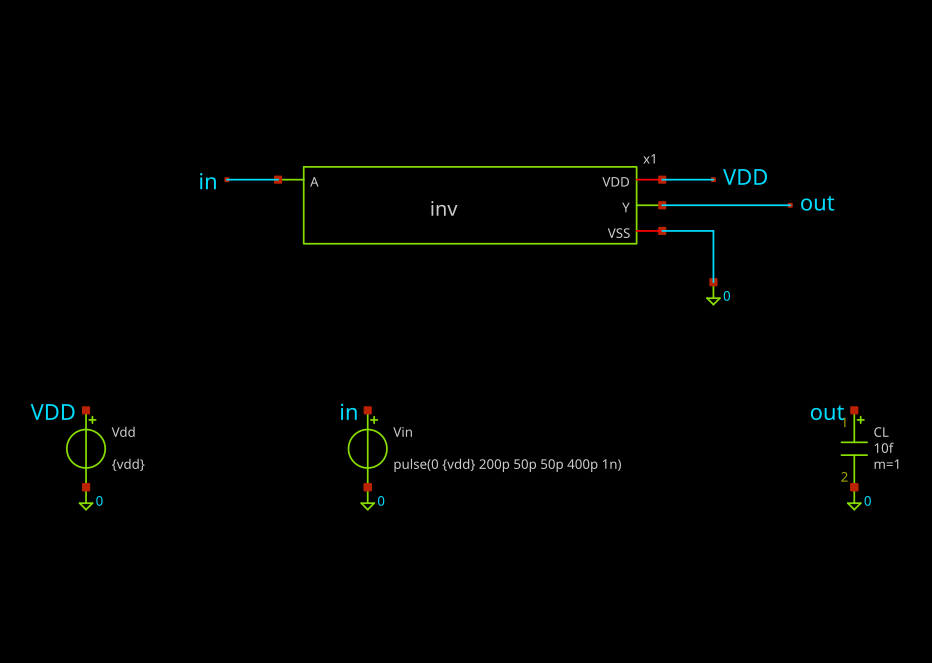

# Inverter 3: the symbol and a testbench

<!-- Made from cdept-gui/tutorials/inv-symbol.toml by `cdept tutorial inv-symbol --print`. Edit that file, not this one. -->

You give the inverter a symbol, so that it can be used as a part in another
schematic, and draw its testbench: the inverter with a supply, an input signal and a
load. This is how every analog block is simulated: the block alone, in a circuit that
plays the rest of the chip.

About 20 minutes. To be guided through it inside CDePT:

```sh
cdept tutorial inv-symbol
```

## Before you start

- [Inverter 2](inv-schematic.md), or let the guide make the starting project.
- CDePT built with the xschem helper (`cargo build -p cdept-xschem`).

## 1. Get the project

Either let the guide make the starting project (the inverter of "Inverter 2" is drawn
in it), or open your own project from "Inverter 2" and press Continue.

## 2. Open the schematic of inv

In the Libraries panel on the left, open "work", then "inv", and double-click
"schematic".

## 3. Make the symbol

A symbol is the small drawing that stands for a cell inside another schematic: a box
with the cell's pins. xschem can draw it from the pins of the schematic.

With the pointer over the drawing, press a (or open the Symbol menu and click "Make
symbol from schematic"). xschem asks "do you want to make symbol view?": press OK.

CDePT puts the symbol into the cell's own "symbol" view, and the symbol names the
schematic it belongs to.

## 4. Look at the symbol

In the Libraries panel, double-click "symbol" under inv.

The input A is on the left; the output Y and the supplies VDD and VSS are on the
right. Their names and directions come from the pins you drew. "@symname" shows the
cell's name and "@name" the name each copy gets (x1, x2, …) when it is placed.

The order of the pins in the netlist is the symbol's, so netlists use the symbol
from now on. If you add or rename a pin in the schematic, make the symbol again.



## 5. A cell for the testbench

A testbench is a design too: it gets a cell of its own. By convention it is named
after the cell it tests, with tb_ in front.

Open the Library Manager with Tools > Library Manager.

## 6. Make the cell tb_inv

Click the library "work" in the first column, then press "+ Cell" in the toolbar.

## 7. Name it tb_inv

Type this as the name, keep the first view "xschem schematic", and press Create:

    tb_inv

## 8. Open the testbench schematic

Double-click the view "schematic" of tb_inv. Then draw the testbench below. This is
what it will look like:



## 9. Place your inverter

Press Insert over the drawing. In the picker choose the library work, the cell inv
and the view symbol, then press Insert. Click in the upper middle of the drawing.

You are now using your own cell as a part: this is the hierarchy. The testbench only
sees the four pins; what is inside comes from the schematic of inv.

The guide checks the schematic `work/tb_inv/schematic`:

| Part | Symbol | Values | Pins on nets |
|---|---|---|---|
| the inverter | `inv` |  |  |

## 10. Add the sources and the load

Press Insert, choose "xschem devices" in the Library column, and place:

- two voltage sources (vsource), below the inverter;
- one capacitor (capa), below the output.

Then set each one: click it, press q, change the text and press OK.

The supply. Name it Vdd; its voltage is the design variable vdd, which the testbench
sets (1.2 V for this PDK's low-voltage transistors):

    name=Vdd value={vdd} savecurrent=false

The input. A pulse source: from 0 to vdd after 200 ps, 50 ps to rise and to fall,
400 ps high, repeated every 1 ns. Keep the quotes, the value has spaces:

    name=Vin value="pulse(0 {vdd} 200p 50p 50p 400p 1n)" savecurrent=false

The load. 10 fF stands for the gates this inverter would drive, a few small
transistors:

    name=CL value=10f m=1

The names matter: the test templates of the next tutorials drive Vin.

The guide checks the schematic `work/tb_inv/schematic`:

| Part | Symbol | Values | Pins on nets |
|---|---|---|---|
| the inverter | `inv` |  |  |
| the supply source Vdd | `vsource` | `name=Vdd` `value={vdd}` |  |
| the input source Vin | `vsource` | `name=Vin` `value=pulse(0 {vdd} 200p 50p 50p 400p 1n)` |  |
| the load capacitor CL | `capa` | `name=CL` `value=10f` |  |

## 11. Connect it with labels and grounds

Wires with the same name are connected, so you need no long wires: put a label on
each point that belongs to a net.

- Alt+L places a label (lab_pin) at the pointer. Put it right on a pin (the little
  square), or draw a short wire from the pin (w) and put the label at its end. Then
  select it, press q and set lab=. Shift+F mirrors a label while you place it.
- The nets are: in (input of the inverter and top of Vin), out (output Y and top of
  CL) and VDD (the inverter's VDD and top of Vdd).
- Every other pin goes to ground: insert gnd from "xschem devices" under the bottom
  of each source and of the capacitor, and on the inverter's VSS. Ground is net 0,
  the reference every voltage is measured from.

The names are in small letters except VDD. The list below shows what is missing.


The guide checks the schematic `work/tb_inv/schematic`:

| Part | Symbol | Values | Pins on nets |
|---|---|---|---|
| the inverter | `inv` |  | `A=in` `VDD=VDD` `VSS=0` `Y=out` |
| the supply source Vdd | `vsource` | `name=Vdd` `value={vdd}` | `m=0` `p=VDD` |
| the input source Vin | `vsource` | `name=Vin` `value=pulse(0 {vdd} 200p 50p 50p 400p 1n)` | `m=0` `p=in` |
| the load capacitor CL | `capa` | `name=CL` `value=10f` | `m=0` `p=out` |

## 12. Save

Press Ctrl+S over the drawing and answer Yes.

The guide checks the schematic `work/tb_inv/schematic`:

| Part | Symbol | Values | Pins on nets |
|---|---|---|---|
| the inverter | `inv` |  | `A=in` `VDD=VDD` `VSS=0` `Y=out` |
| the supply source Vdd | `vsource` | `name=Vdd` `value={vdd}` | `m=0` `p=VDD` |
| the input source Vin | `vsource` | `name=Vin` `value=pulse(0 {vdd} 200p 50p 50p 400p 1n)` | `m=0` `p=in` |
| the load capacitor CL | `capa` | `name=CL` `value=10f` | `m=0` `p=out` |

## 13. Netlist the hierarchy

In the menu bar, open Cell > Netlist to View > SPICE.

## 14. Read it

Open the new "netlist" view of tb_inv from the Libraries panel. It has the testbench:

    x1 VDD in out 0 inv
    Vdd VDD 0 {vdd}
    Vin in 0 pulse(0 {vdd} 200p 50p 50p 400p 1n)
    CL out 0 10f

and below it the inverter's own netlist, as a subcircuit:

    .subckt inv VDD A Y VSS

The line x1 connects the nets VDD, in, out and 0 to the subcircuit's pins in that
order. {vdd} stays as it is: the testbench setup gives it a value when you
simulate.

Next: "Inverter 4: the first simulation".
