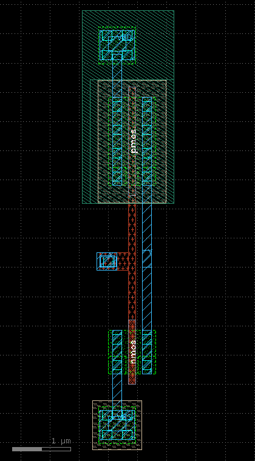

# Inverter 7: DRC and LVS

<!-- Made from cdept-gui/tutorials/inv-verify.toml by `cdept tutorial inv-verify --print`. Edit that file, not this one. -->

You check a layout with the foundry's design rules (DRC) and against its schematic
(LVS), read what they report, find the mistake, fix it and finish with both clean.

About 20 minutes. To be guided through it inside CDePT:

```sh
cdept tutorial inv-verify
```

## Before you start

- [Inverter 6](inv-layout.md) explains the layout. This tutorial starts from a copy of
  it with one mistake in it, which the guide makes for you.
- KLayout built for CDePT (`cdept-klayout/build.sh`) and the xschem helper.

## 1. Get the project

Let the guide make the starting project: the inverter's layout, routed, with one
mistake in it. (Your own layout from "Inverter 6" works too, but then there may be
nothing to find.)

## 2. Open the layout

In the Libraries panel, open "work", then "inv", and double-click "layout". If CDePT
asks what to open it with, choose KLayout.

## 3. Two different questions

Two checks stand between a drawing and a chip.

DRC (design rule check) asks: can the foundry make this? It looks at widths,
spacings, enclosures and the like. It knows nothing of your circuit.

LVS (layout versus schematic) asks: is it your circuit? It extracts devices and
connections from the shapes and compares them, sizes included, with the schematic.

A layout needs both. This one looks complete. It is not.



## 4. Run DRC

Click "DRC" in the toolbar (or Layout > Run DRC). CDePT writes the layout as it is
now, unsaved changes included, and runs the PDK's rule deck on it. This takes some
seconds.

## 5. Read the violation

The panel under the picture lists the broken rules with how often each is broken.
Open the rule to see its places, and click one: the picture zooms to it. "Show all"
marks every place of a rule. The text of the rule says what is required.

Here it is M1.b: two Metal1 shapes (or two parts of one) are closer than 0.18 µm.
Look where it is: at the bottom, between the VSS strap and the substrate contact.

A spacing error often means something else: two shapes that were meant to be one.

## 6. Run LVS

Now click "LVS". CDePT netlists the schematic, extracts the layout with the PDK's LVS
deck and compares the two.

## 7. Read the mismatch

LVS says the layout does not match. Its list names nets and devices it could not
pair. Read it from the net names you know: VSS of the schematic has no partner, there
is an extra unnamed net in the layout, and the NMOS (M1) does not match, because its
source is not on VSS.

One cause often shows as many mismatches. Start with the nets, not the devices.

## 8. Find the open net

CDePT's net check says the same in a quicker and clearer way. Run Layout > Update
Connectivity.

The Nets panel shows VSS as open, and flylines join its pieces in the picture: the
NMOS source on one side, the VSS pin and the bulk on the other. Click VSS in the
panel to light it up. Zoom into the gap: the strap ends just short of the contact's
metal.

## 9. Fix it

The strap stops at y = -0.4; the metal of the contact below ends at y = -0.45. Draw a
Metal1 box over the gap that runs well into the contact's metal:

    0.07, -0.6, 0.23, -0.35

(Or select the strap, press Q and change its bottom to -0.6.)

Choose Metal1.drawing, then Box, zoom in on each corner, and click both. The flylines
disappear as the pieces join.

The result panels at the bottom take room from the picture: press their "Close"
buttons if there is too little left.

## 10. DRC again

A result counts only for the layout it was made from, so every change means running
the checks again. Click "DRC".

## 11. LVS again

Click "LVS". This time the panel says: The layout matches the schematic.

If it does not, run Update Connectivity again and see which net is not ok.

## 12. Save

Press Ctrl+S. The checks ran on the layout in the window; only saving puts it on
disk.

## 13. What you can now do

Your inverter passes the foundry's rules and is the circuit you drew.

The same checks run from a terminal, which is useful in scripts:

    cdept -p <your project folder> layout drc work inv
    cdept -p <your project folder> layout lvs work inv
    cdept -p <your project folder> layout check-nets work inv

Their reports are kept under ~/.cache/cdept/verify/ ; the .lyrdb and .lvsdb files open
in KLayout's own browsers.

Not covered here: density and fill rules of a whole chip, antenna rules beyond what
the deck checks, and parasitic extraction (CDePT can extract capacitances with Magic
from a terminal, but cannot simulate the extracted circuit yet).
