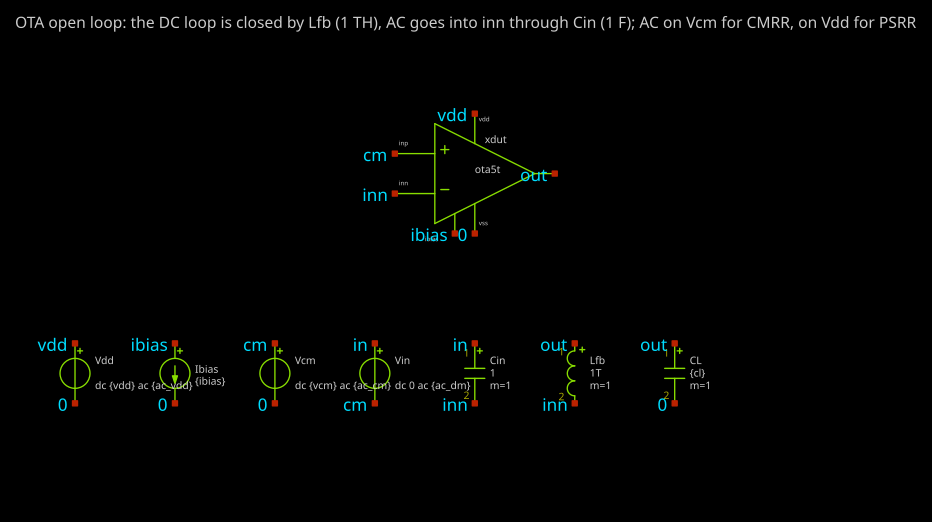

# OTA 2: the operating point

<!-- Made from cdept-gui/tutorials/ota-bias.toml by `cdept tutorial ota-bias --print`. Edit that file, not this one. -->

You make a testbench for the OTA's DC operating point, run it, and check the bias:
the currents, the node voltages, and that all six transistors are in saturation.

About 20 minutes. To be guided through it inside CDePT:

```sh
cdept tutorial ota-bias
```

## Before you start

- [OTA 1](ota-schematic.md) to know the circuit (the starting project has it).
- ngspice and the xschem helper.

## 1. Get the project

Make the starting project. It has the OTA (schematic, and a symbol drawn as the
amplifier triangle) and two testbench schematics.

## 2. The open-loop testbench

tb_ota5t is the testbench you will use most. Around the OTA (xdut):

- Vdd, the 1.2 V supply, and Ibias, which pulls 20 µA out of ibias.
- Vcm holds inp at the common-mode voltage.
- At DC the inductor Lfb (1 TH) is a short: out is tied to inn. This closes the loop,
  so the output settles by itself at about the input voltage. Without it, a gain of
  60 would turn a few millivolts of offset into a railed output.
- For AC, Lfb is open and the capacitor Cin (1 F) a short: inn follows the source
  Vin. The loop is open exactly when you want to measure the open-loop gain.

Sizes like 1 TH and 1 F exist only in a simulator; they do this job well.

The values in braces, {vdd}, {vcm}, {ibias}, {cl}, {ac_dm}..., are design variables:
each testbench view gives them values.



## 3. Select the testbench cell

In the Libraries panel, open "work" and click the cell "tb_ota5t". A testbench view
made in this cell simulates this cell's schematic.

## 4. New testbench

Open Tools > New Testbench…. A testbench view is a setup file: which template, which
corners, what to measure and which limits (specs) to check.

## 5. Pick the template ota_op

In "Template", choose ota_op (scroll the list). It is a project template, kept in the
project's templates/ folder: a measurement written once for this circuit. It saves
the operating point of M1 to M6 and computes sat_margin, the smallest vds - vdss
over the six (vdss is the saturation voltage of this PDK's model). A transistor with a
negative margin has left saturation.

## 6. Create it

The cell must be tb_ota5t and the view ota_op. The parameters are the limits:
saturation margin at least 30 mV, output 0.40 to 0.45 V, supply current at most
60 µA. Press "Create". The new view opens in the Simulation tab.

## 7. Add the design variables, and save

The template gives vdd and the AC sources (all 0 here). Three values are design
choices and yours to give. In the Simulation tab, click the heading "Test template" to
fold it away, then under "Variables" press "+ Add" three times and fill in the new
rows:

- vcm = 0.42  (the input common-mode voltage)
- ibias = 20u  (the bias current)
- cl = 100f  (the load capacitance)

Then press "Save".

## 8. Run

Press "Run". CDePT netlists the testbench with xschem, adds the models of the typical
corner and runs ngspice. It takes a second or two.

## 9. Read the results

Fold "Setup" away (click its heading) to see the results; scroll if needed. Expect:

- vout 0.4225 V: the loop holds the output near vcm = 0.42 V. The 2.5 mV left over is
  the OTA's own (systematic) offset.
- isupply 39.8 µA: 20 µA in the diode M6 and 19.8 µA of tail current in M5. A mirror
  copies well when both drains sit at similar voltages; here M5's vds is 0.39 V and
  M6's 0.46 V.
- tail 0.815 V: it sits one |VGS| of the PMOS pair above the inputs.
- sat_margin 127 mV: every transistor is saturated. The smallest is M4's: its vds
  is 0.42 V and its vdss 0.30 V.

All three specs pass. This is one corner, tt, at 27 °C. "OTA 7" runs all corners, and
something there is not so good.

## 10. See the voltages on the schematic (optional)

xschem can write the operating point onto the testbench schematic. Open
tb_ota5t's "schematic", then in the menu bar Waves > Op Annotate. A file window
opens: choose this file in your project:

    simulations/work/tb_ota5t/ota_op/tt/out.raw

The node voltages appear in red next to the pins, and the supply current next to Vdd.
Select the OTA and press e to descend into it: the tail node and the mirror node show
their voltages too. Ctrl+E goes back up: if xschem asks "save file?", answer No.

## 11. What you checked

Before any AC or transient figure: currents as intended, node voltages with headroom,
every transistor saturated with some margin. Check this again after every change of a
size.

Next: "OTA 3: gain and phase margin".
