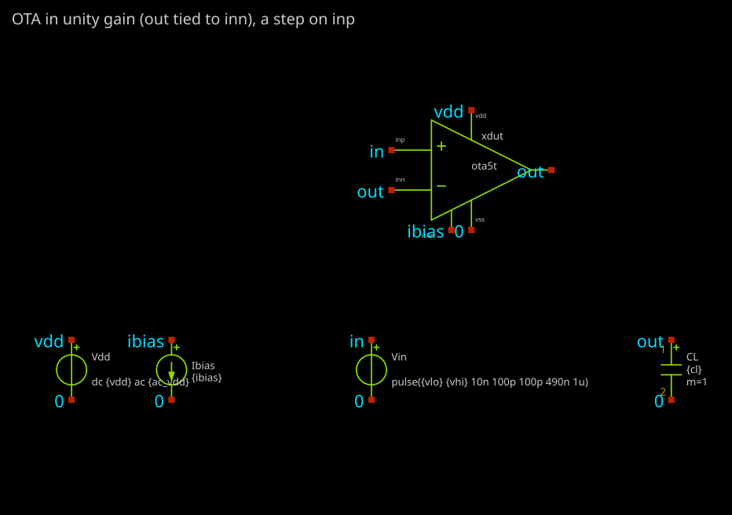

# OTA 8: input offset and mismatch

<!-- Made from cdept-gui/tutorials/ota-mismatch.toml by `cdept tutorial ota-mismatch --print`. Edit that file, not this one. -->

You simulate how the input offset scatters from chip to chip because no two
transistors are exactly alike (Monte Carlo mismatch), and find which transistors
cause most of it.

About 20 minutes. To be guided through it inside CDePT:

```sh
cdept tutorial ota-mismatch
```

## Before you start

- [OTA 4](ota-step.md): the follower testbench.

## 1. Get the project

Make the starting project.

## 2. Measuring offset

Two transistors drawn alike differ a little: threshold voltage, mobility, size.
In the follower, out = inp - offset (times A/(1+A) = 0.98, close enough). So hold
both levels of the step at the same voltage, 0.42 V, and the offset is out - 0.42 V.

An operating point is enough, so the template is the built-in dc_op, with limits on
vout: 0.41 to 0.43 V, an offset within 10 mV.



## 3. Select tb_ota5t_step

In the Libraries panel, click the cell "tb_ota5t_step".

## 4. New testbench: offset

Open Tools > New Testbench….

## 5. The template dc_op

Choose dc_op.

## 6. Fill in, then Create

Change the view name to

    offset

and set vout_min = 0.41 and vout_max = 0.43. Press "Create".

## 7. Hold the input still

The variables come from the step testbench. In the Variables list (fold "Test
template") set

- vlo = 0.42
- vhi = 0.42

Press "Save".

## 8. Run

Press "Run": first without Monte Carlo.

## 9. The systematic offset

vout = 0.4225 V: an offset of +2.5 mV although every transistor is ideal. This is
the systematic offset: the two sides of the OTA do not see the same voltages (OTA 6).
It is the same on every chip, and a design change can remove it.

## 10. Turn Monte Carlo on

Under "Setup", near the bottom (scroll), tick "Monte Carlo". Then:

- Runs: 200 (the first field), seed 1 (the second);
- Draws: mismatch. Not "process": that moves all transistors together, which barely
  changes the offset.

Press "Save". "Mismatch" draws a new random threshold and size for every transistor
in each run, with a spread that shrinks as the gate area grows. The PDK's tt_mm corner
does this.

## 11. Run the 200 samples

Press "Run". The line under the toolbar says 200 run points. It takes some seconds.
Press Continue when the results are there.

## 12. Read the statistics

Fold "Setup". The statistics of vout over the 200 runs (seed 1, so you get the same
numbers):

- mean 0.4226 V: the systematic 2.6 mV.
- std 0.97 mV: the random offset, sigma.
- min 0.4195, max 0.4253 V; all 200 within the 10 mV limit.

So an offset of 2.6 mV ± 2.9 mV (3 sigma). With 200 samples sigma itself is only
known to about 5 %; more runs sharpen it.

## 13. Which transistors?

Mismatch averages out over area: a device of twice the area has 1/√2 of the random
spread. Double the input pair and see how much sigma falls. Open the OTA's schematic.

## 14. m=2 on M1 and M2

Set m=2 on M1 and on M2 (q, then OK).

The guide checks the schematic `work/ota5t/schematic`:

| Part | Symbol | Values | Pins on nets |
|---|---|---|---|
| M5, the tail current source | `sg13_lv_pmos` | `l=1u` `m=1` `ng=4` `w=32u` | `B=vdd` `D=(the tail net)` `G=ibias` `S=vdd` |
| M6, the diode that sets the bias | `sg13_lv_pmos` | `l=1u` `m=1` `ng=4` `w=32u` | `B=vdd` `D=ibias` `G=ibias` `S=vdd` |
| M1, the input transistor on inp | `sg13_lv_pmos` | `l=0.5u` `m=2` `ng=4` `w=30u` | `B=(the tail net)` `D=(the mirror net)` `G=inp` `S=(the tail net)` |
| M2, the input transistor on inn | `sg13_lv_pmos` | `l=0.5u` `m=2` `ng=4` `w=30u` | `B=(the tail net)` `D=out` `G=inn` `S=(the tail net)` |
| M3, the mirror's diode | `sg13_lv_nmos` | `l=4u` `m=1` `w=2u` | `B=vss` `D=(the mirror net)` `G=(the mirror net)` `S=vss` |
| M4, the mirror's output | `sg13_lv_nmos` | `l=4u` `m=1` `w=2u` | `B=vss` `D=out` `G=(the mirror net)` `S=vss` |
| the input pin inp | `ipin` | `lab=inp` |  |
| the input pin inn | `ipin` | `lab=inn` |  |
| the bias input pin ibias | `ipin` | `lab=ibias` |  |
| the output pin out | `opin` | `lab=out` |  |
| the supply pin vdd | `iopin` | `lab=vdd` |  |
| the ground pin vss | `iopin` | `lab=vss` |  |

## 15. Save the schematic

The Monte Carlo simulates the saved schematic.

Save with Ctrl+S (answer Yes).

The guide checks the schematic `work/ota5t/schematic`:

| Part | Symbol | Values | Pins on nets |
|---|---|---|---|
| M5, the tail current source | `sg13_lv_pmos` | `l=1u` `m=1` `ng=4` `w=32u` | `B=vdd` `D=(the tail net)` `G=ibias` `S=vdd` |
| M6, the diode that sets the bias | `sg13_lv_pmos` | `l=1u` `m=1` `ng=4` `w=32u` | `B=vdd` `D=ibias` `G=ibias` `S=vdd` |
| M1, the input transistor on inp | `sg13_lv_pmos` | `l=0.5u` `m=2` `ng=4` `w=30u` | `B=(the tail net)` `D=(the mirror net)` `G=inp` `S=(the tail net)` |
| M2, the input transistor on inn | `sg13_lv_pmos` | `l=0.5u` `m=2` `ng=4` `w=30u` | `B=(the tail net)` `D=out` `G=inn` `S=(the tail net)` |
| M3, the mirror's diode | `sg13_lv_nmos` | `l=4u` `m=1` `w=2u` | `B=vss` `D=(the mirror net)` `G=(the mirror net)` `S=vss` |
| M4, the mirror's output | `sg13_lv_nmos` | `l=4u` `m=1` `w=2u` | `B=vss` `D=out` `G=(the mirror net)` `S=vss` |
| the input pin inp | `ipin` | `lab=inp` |  |
| the input pin inn | `ipin` | `lab=inn` |  |
| the bias input pin ibias | `ipin` | `lab=ibias` |  |
| the output pin out | `opin` | `lab=out` |  |
| the supply pin vdd | `iopin` | `lab=vdd` |  |
| the ground pin vss | `iopin` | `lab=vss` |  |

## 16. Back to the offset testbench

Open the view offset again.

## 17. Run again

Press "Run", and press Continue when it is done.

## 18. What the pair contributes

std falls from 0.97 mV to 0.74 mV.

Independent sources add as squares: sigma² = pair² + rest². If doubling the pair's
area halves pair², the two measurements give pair = 0.89 mV and rest = 0.39 mV (the
mirror and the rest). With m=4 the same arithmetic predicts 0.59 mV, and that is what
this circuit simulates.

Doubling the mirror instead barely helps: with m=4 on M3 and M4 sigma is 0.93 mV. The
pair's mismatch acts directly at the input; the mirror's is divided by gm1/gm3 = 3.5
on the way back to the input. Spend area on the pair first. In layout, the two
transistors of a pair must also sit side by side, alike in orientation and
surroundings: a layout that breaks this adds offset that this simulation does not
know about.

Next: "OTA 9: noise".
