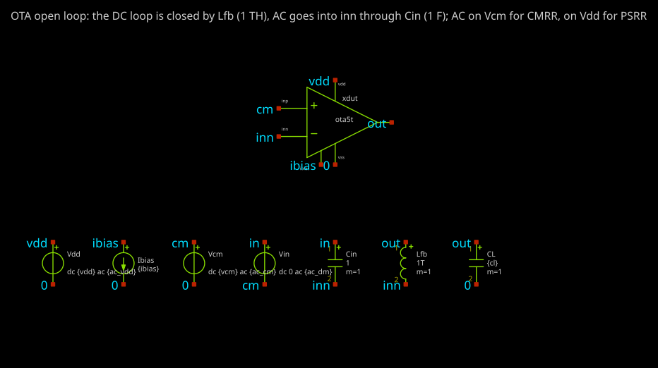

# OTA 9: noise

<!-- Made from cdept-gui/tutorials/ota-noise.toml by `cdept tutorial ota-noise --print`. Edit that file, not this one. -->

You simulate the OTA's noise, separate flicker from thermal noise, find the corner
frequency between them, and see what a larger input pair does.

About 20 minutes. To be guided through it inside CDePT:

```sh
cdept tutorial ota-noise
```

## Before you start

- [OTA 3](ota-ac.md): the open-loop testbench and the gain.

## 1. Get the project

Make the starting project.

## 2. Noise referred to the input

Every transistor adds noise. At the output it is multiplied by the gain, so it is
compared as input-referred noise: the noise voltage at the input that would give the
same output noise, in V/√Hz.

The open-loop testbench serves: above DC the loop is open, and Vin drives inn. The
noise analysis refers everything to Vin, which needs an AC value (ac_dm = 1).

For thermal noise a hand estimate is 8kT·γ/gm1 · (1 + gm3/gm1) for the pair and the
mirror. With the long-channel γ = 2/3, gm1 = 201 µS and gm3 = 57 µS, it gives
11.9 nV/√Hz.



## 3. Select tb_ota5t

In the Libraries panel, click the cell "tb_ota5t".

## 4. New testbench: noise

Open Tools > New Testbench….

## 5. The template noise

Choose noise.

## 6. Fill in, then Create

Set:

- fstart = 1 (Hz)
- fspot = 10meg: the frequency of the spot-noise figures, far above the flicker noise

src is vin and fstop 1G. Press "Create".

## 7. Run

The variables come from the AC testbench (ac_dm = 1). Press "Run".

## 8. Thermal noise

- spot_in 16.1 nV/√Hz at 10 MHz: the input-referred noise. The estimate was 11.9:
  these short, moderately inverted transistors are noisier than the long-channel
  formula says.
- spot_out 377 nV/√Hz, at the output.
- int_out 3.1 mV rms: the output noise from 1 Hz to 1 GHz, the number a following
  stage sees.
- int_in is the input-referred noise summed up to 1 GHz. It counts frequencies where
  the gain is gone and the input-referred value grows large, so it says little here.

## 9. The noise spectrum

Press "Waveform Tab": it shows the input- and output-referred noise against frequency.

## 10. Two regions

At low frequency the input-referred noise falls with a slope: flicker (1/f) noise.
Then it flattens: thermal noise. Put cursor A on the curve (click) to read values.

## 11. Measure the flicker noise

Open the view noise again.

## 12. Spot noise at 1 kHz

Under "Test template" set fspot = 1k, "Save", "Run". Press Continue when the result
is there.

## 13. The corner frequency

spot_in is now 277 nV/√Hz at 1 kHz, seventeen times the thermal 16 nV/√Hz.

Flicker noise power falls as 1/f, so it equals the thermal noise power where
f = 1 kHz × (277 / 16.1)² ≈ 300 kHz. Check: at 100 kHz the two should add to
√(16.1² + 277²/100) = 32 nV/√Hz (set fspot = 100k if you like: 31.8).

For signals below some hundred kHz, flicker noise is what counts.

## 14. A larger pair

Flicker noise falls with gate area, like mismatch. Open the OTA's schematic.

## 15. m=4 on M1 and M2

Set m=4 on M1 and on M2.

The guide checks the schematic `work/ota5t/schematic`:

| Part | Symbol | Values | Pins on nets |
|---|---|---|---|
| M5, the tail current source | `sg13_lv_pmos` | `l=1u` `m=1` `ng=4` `w=32u` | `B=vdd` `D=(the tail net)` `G=ibias` `S=vdd` |
| M6, the diode that sets the bias | `sg13_lv_pmos` | `l=1u` `m=1` `ng=4` `w=32u` | `B=vdd` `D=ibias` `G=ibias` `S=vdd` |
| M1, the input transistor on inp | `sg13_lv_pmos` | `l=0.5u` `m=4` `ng=4` `w=30u` | `B=(the tail net)` `D=(the mirror net)` `G=inp` `S=(the tail net)` |
| M2, the input transistor on inn | `sg13_lv_pmos` | `l=0.5u` `m=4` `ng=4` `w=30u` | `B=(the tail net)` `D=out` `G=inn` `S=(the tail net)` |
| M3, the mirror's diode | `sg13_lv_nmos` | `l=4u` `m=1` `w=2u` | `B=vss` `D=(the mirror net)` `G=(the mirror net)` `S=vss` |
| M4, the mirror's output | `sg13_lv_nmos` | `l=4u` `m=1` `w=2u` | `B=vss` `D=out` `G=(the mirror net)` `S=vss` |
| the input pin inp | `ipin` | `lab=inp` |  |
| the input pin inn | `ipin` | `lab=inn` |  |
| the bias input pin ibias | `ipin` | `lab=ibias` |  |
| the output pin out | `opin` | `lab=out` |  |
| the supply pin vdd | `iopin` | `lab=vdd` |  |
| the ground pin vss | `iopin` | `lab=vss` |  |

## 16. Save the schematic

The noise analysis simulates the saved schematic.

Save with Ctrl+S (answer Yes).

The guide checks the schematic `work/ota5t/schematic`:

| Part | Symbol | Values | Pins on nets |
|---|---|---|---|
| M5, the tail current source | `sg13_lv_pmos` | `l=1u` `m=1` `ng=4` `w=32u` | `B=vdd` `D=(the tail net)` `G=ibias` `S=vdd` |
| M6, the diode that sets the bias | `sg13_lv_pmos` | `l=1u` `m=1` `ng=4` `w=32u` | `B=vdd` `D=ibias` `G=ibias` `S=vdd` |
| M1, the input transistor on inp | `sg13_lv_pmos` | `l=0.5u` `m=4` `ng=4` `w=30u` | `B=(the tail net)` `D=(the mirror net)` `G=inp` `S=(the tail net)` |
| M2, the input transistor on inn | `sg13_lv_pmos` | `l=0.5u` `m=4` `ng=4` `w=30u` | `B=(the tail net)` `D=out` `G=inn` `S=(the tail net)` |
| M3, the mirror's diode | `sg13_lv_nmos` | `l=4u` `m=1` `w=2u` | `B=vss` `D=(the mirror net)` `G=(the mirror net)` `S=vss` |
| M4, the mirror's output | `sg13_lv_nmos` | `l=4u` `m=1` `w=2u` | `B=vss` `D=out` `G=(the mirror net)` `S=vss` |
| the input pin inp | `ipin` | `lab=inp` |  |
| the input pin inn | `ipin` | `lab=inn` |  |
| the bias input pin ibias | `ipin` | `lab=ibias` |  |
| the output pin out | `opin` | `lab=out` |  |
| the supply pin vdd | `iopin` | `lab=vdd` |  |
| the ground pin vss | `iopin` | `lab=vss` |  |

## 17. Run again

Open the view noise (fspot is still 1k).

## 18. Run

Press "Run", and Continue when it is done.

## 19. What area bought

spot_in at 1 kHz falls from 277 to 145 nV/√Hz: the noise power is 0.27 of what it was.
Four times the pair's area would give 0.25 if all flicker noise came from the pair:
nearly all of it does.

Thermal noise falls less (13.2 instead of 16.1 nV/√Hz at 10 MHz): it comes from gm,
which grew a little. The price is in OTA 5: with m=4 the phase margin is 49°. Noise,
speed and stability are traded against each other, and a suite (OTA 7) shows all of
them at once.

That ends the OTA series.
