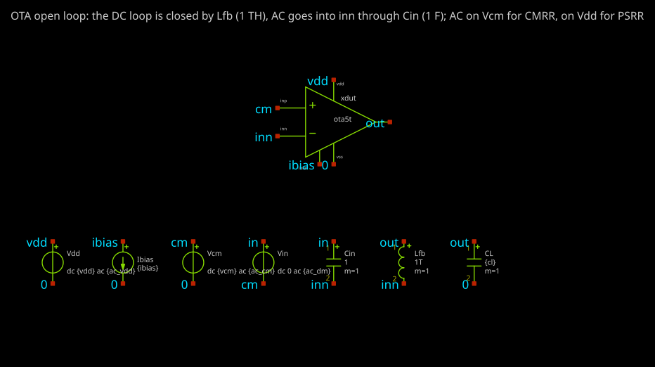

# OTA 6: supply and common-mode rejection, and power

<!-- Made from cdept-gui/tutorials/ota-rejection.toml by `cdept tutorial ota-rejection --print`. Edit that file, not this one. -->

You measure how much of the supply's and the input common mode's disturbance reaches
the output (PSRR, CMRR), find where the common-mode gain comes from, and measure the
power.

About 25 minutes. To be guided through it inside CDePT:

```sh
cdept tutorial ota-rejection
```

## Before you start

- [OTA 3](ota-ac.md) and [OTA 4](ota-step.md).

## 1. Get the project

Make the starting project.

## 2. Two more AC measurements

The same open-loop testbench, with the AC source somewhere else:

- PSRR: 1 V AC on the supply (ac_vdd = 1), no input signal.
- CMRR: 1 V AC on the common-mode source Vcm (ac_cm = 1), which moves both inputs
  together.

The template psrr_cmrr reads out over the stimulated node at 1 kHz (xfer_db). Given
the differential gain adm_db (35.2 dB, from OTA 3), the rejection is adm_db -
xfer_db: how much smaller a disturbance acts than a signal at the input.



## 3. Select tb_ota5t

In the Libraries panel, click the cell "tb_ota5t".

## 4. New testbench: psrr

Open Tools > New Testbench….

## 5. The template psrr_cmrr

Choose psrr_cmrr.

## 6. Fill in, then Create

Change the view name to

    psrr

Leave mode at psrr and set adm_db = 35.2 and rejection_min = 50. Press "Create".

## 7. Stimulus on the supply

CDePT copied the design variables from another testbench of this schematic. Set the
three AC variables so that only the supply is driven:

- ac_dm = 0
- ac_cm = 0
- ac_vdd = 1

(vbias is not used.) Then press "Save".

## 8. Run

Press "Run".

## 9. PSRR

- xfer_db -30.9 dB: supply ripple arrives at out 35 times smaller (psrr_db is the same
  number with the sign turned).
- rejection_db 66.1 dB: referred to the input, supply ripple acts like a signal 2000
  times smaller.

Both numbers are called PSRR in places. Say which one you mean.

## 10. Select tb_ota5t

In the Libraries panel, click the cell "tb_ota5t".

## 11. New testbench: cmrr

Open Tools > New Testbench….

## 12. psrr_cmrr again

Choose psrr_cmrr again.

## 13. Fill in, then Create

Change the view name to

    cmrr

Set mode = cmrr, stim = cm, adm_db = 35.2 and rejection_min = 40. Press "Create".

## 14. Stimulus on the common mode

Set the AC variables so that only the common mode is driven:

- ac_dm = 0
- ac_vdd = 0
- ac_cm = 1

Then "Save".

## 15. Run

Press "Run".

## 16. CMRR, and where it comes from

cm_gain_db -10.1 dB, rejection_db 45.3 dB.

The textbook term is the tail source's finite resistance against the mirror:
gds5 / (2 · gm3) = 2.50 µS / (2 · 57.4 µS) = 0.022, which would be -33 dB. The
simulation says -10 dB, so something else dominates.

M1 and M2 do not see the same voltages: M1's drain is on the mirror node at 0.56 V,
M2's on out at 0.42 V, so M1 has less vds (0.26 V against 0.39 V) and a larger gds
(2.75 against 1.74 µS). A common-mode step changes the vds of both alike, and their
different gds turn it into a difference current:
(gds1 - gds2) / (gds2 + gds4) = 0.296. Added to the tail term: 0.318, which is
-10.0 dB. The simulation says -10.1 dB.

So the OTA's common-mode rejection is set mostly by the mirror's gate voltage, not by
the tail. Keep that in mind for "OTA 7".

## 17. Select tb_ota5t_step

In the Libraries panel, click the cell "tb_ota5t_step".

## 18. New testbench: power

Open Tools > New Testbench….

## 19. The template power

Choose power.

## 20. Fill in, then Create

It averages the supply current of the follower over one period of its 1 µs pulse.
Set step = 200p, stop = 1u, period = 1u, i_avg_max = 50u and p_avg_max = 60u, then
press "Create".

## 21. Run

The variables come from the step testbench. Press "Run".

## 22. Power

- i_avg 39.8 µA: the 20 µA bias branch and the 19.8 µA tail. A class-A amplifier draws
  its current whether it works or not.
- p_avg 47.8 µW.
- p_peak 74.8 µW, during the edges.

Next: "OTA 7: all corners".
