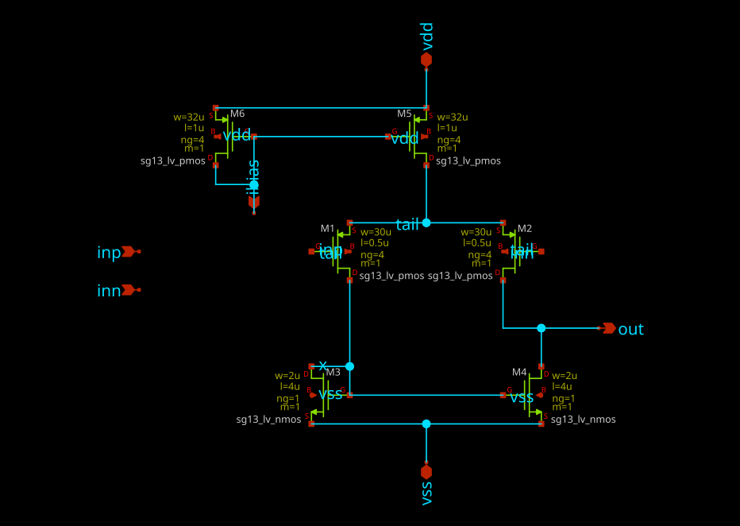
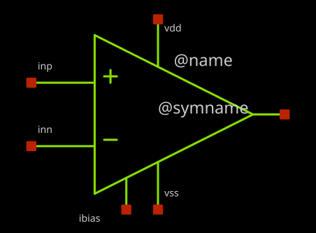

# OTA 1: draw the five-transistor OTA

<!-- Made from cdept-gui/tutorials/ota-schematic.toml by `cdept tutorial ota-schematic --print`. Edit that file, not this one. -->

You draw a five-transistor operational transconductance amplifier (OTA) in IHP
SG13G2, understand what each pair of transistors does, and make its symbol. The other
OTA tutorials analyse this circuit.

About 30 minutes. To be guided through it inside CDePT:

```sh
cdept tutorial ota-schematic
```

## Before you start

- The schematic skills of [Inverter 2](inv-schematic.md): placing, sizing, pins,
  wires. They are not explained again here.
- CDePT built with the xschem helper (`cargo build -p cdept-xschem`).

## 1. Get the project

Let the guide make the starting project: a library "work" with an empty cell
"ota5t". Or use a project of your own that has an empty work/ota5t/schematic.

## 2. Open the schematic of ota5t

In the Libraries panel, open "work", then "ota5t", and double-click "schematic".

## 3. What the circuit does

An OTA turns a voltage difference into a current. Six transistors do it here, in
three pairs:

- M6 and M5, a PMOS current mirror: 20 µA pulled out of the pin ibias flows through
  M6, and M5 copies it. M5 is the "tail" current source.
- M1 and M2, the PMOS input pair: they share the tail current. Equal inputs split it
  in half; a difference shifts current from one side to the other.
- M3 and M4, an NMOS mirror as load: it copies M1's current to the output side, so
  the output gets M1's current in and M2's current out. Their difference charges
  the output.

The PDK's low-voltage devices (sg13_lv_pmos, sg13_lv_nmos), 1.2 V supply. The input
pair is PMOS, so the inputs work near the lower rail (about 0.4 V here).



## 4. The bias mirror: M6 and M5

Place two sg13_lv_pmos at the top (Insert, library sg13g2_pr). Select each, press q,
and set w=32u, l=1u and ng=4. The names in the picture (M5, M6) matter in these
tutorials: set name= in the same dialog.

ng is the number of gate fingers: 32 µm is drawn as four fingers of 8 µm. The PDK's
checker wants less than 10 µm per finger, and its models are only meant for that: it
complains in the Console about a single wider finger.

Wire both sources (top) and both bulks to vdd, and the two gates together. M6 is a
diode: its gate also goes to its drain, and that node is the pin ibias.

Pins: vdd is an in-out pin (Insert, "xschem devices", iopin), ibias an input pin
(Ctrl+P). M5's drain is the tail: leave it for the next step.

Labels save wires: Alt+L places a label; the same lab= name means the same net. You
may label M5's drain "tail" now.

An mm_ok=1 attribute on each device is what lets Monte Carlo draw mismatch later; the
symbol sets it by itself.

The guide checks the schematic `work/ota5t/schematic`:

| Part | Symbol | Values | Pins on nets |
|---|---|---|---|
| M5, the tail current source | `sg13_lv_pmos` | `l=1u` `m=1` `ng=4` `w=32u` | `B=vdd` `D=(the tail net)` `G=ibias` `S=vdd` |
| M6, the diode that sets the bias | `sg13_lv_pmos` | `l=1u` `m=1` `ng=4` `w=32u` | `B=vdd` `D=ibias` `G=ibias` `S=vdd` |
| the supply pin vdd | `iopin` | `lab=vdd` |  |
| the bias input pin ibias | `ipin` | `lab=ibias` |  |

## 5. The input pair: M1 and M2

Two more PMOS below, w=30u l=0.5u ng=4, named M1 and M2. Their sources and their
bulks all go to M5's
drain, the tail node. The bulks go to the tail and not to vdd: then the bulk follows
the source and there is no body effect on the pair.

M1's gate is the input pin inp, M2's gate the input pin inn. M2's drain is the output
pin out (Ctrl+Shift+P). M1's drain goes to the mirror of the next step.

The pair is large for two reasons you will measure: a wide device gives more gm for
the same current, and a large gate area matches better (OTA 8) and has less flicker
noise (OTA 9).


The guide checks the schematic `work/ota5t/schematic`:

| Part | Symbol | Values | Pins on nets |
|---|---|---|---|
| M5, the tail current source | `sg13_lv_pmos` | `l=1u` `ng=4` `w=32u` | `B=vdd` `D=(the tail net)` `G=ibias` `S=vdd` |
| M6, the diode that sets the bias | `sg13_lv_pmos` | `l=1u` `ng=4` `w=32u` | `B=vdd` `D=ibias` `G=ibias` `S=vdd` |
| M1, the input transistor on inp | `sg13_lv_pmos` | `l=0.5u` `m=1` `ng=4` `w=30u` | `B=(the tail net)` `D=(the mirror net)` `G=inp` `S=(the tail net)` |
| M2, the input transistor on inn | `sg13_lv_pmos` | `l=0.5u` `m=1` `ng=4` `w=30u` | `B=(the tail net)` `D=out` `G=inn` `S=(the tail net)` |
| the input pin inp | `ipin` | `lab=inp` |  |
| the input pin inn | `ipin` | `lab=inn` |  |
| the output pin out | `opin` | `lab=out` |  |

## 6. The mirror load: M3 and M4

Two sg13_lv_nmos at the bottom, w=2u l=4u (one finger), named M3 and M4. Sources and bulks to vss (an in-out pin
vss). M3's gate and drain together, on M1's drain; M4's gate on the same node; M4's
drain on out.

These are long devices (4 µm): a long channel gives a small output conductance, and
the gain of this OTA is the pair's gm over the output conductances.

The list below names what is still wrong, whatever shape your drawing has.


The guide checks the schematic `work/ota5t/schematic`:

| Part | Symbol | Values | Pins on nets |
|---|---|---|---|
| M5, the tail current source | `sg13_lv_pmos` | `l=1u` `m=1` `ng=4` `w=32u` | `B=vdd` `D=(the tail net)` `G=ibias` `S=vdd` |
| M6, the diode that sets the bias | `sg13_lv_pmos` | `l=1u` `m=1` `ng=4` `w=32u` | `B=vdd` `D=ibias` `G=ibias` `S=vdd` |
| M1, the input transistor on inp | `sg13_lv_pmos` | `l=0.5u` `m=1` `ng=4` `w=30u` | `B=(the tail net)` `D=(the mirror net)` `G=inp` `S=(the tail net)` |
| M2, the input transistor on inn | `sg13_lv_pmos` | `l=0.5u` `m=1` `ng=4` `w=30u` | `B=(the tail net)` `D=out` `G=inn` `S=(the tail net)` |
| M3, the mirror's diode | `sg13_lv_nmos` | `l=4u` `m=1` `w=2u` | `B=vss` `D=(the mirror net)` `G=(the mirror net)` `S=vss` |
| M4, the mirror's output | `sg13_lv_nmos` | `l=4u` `m=1` `w=2u` | `B=vss` `D=out` `G=(the mirror net)` `S=vss` |
| the input pin inp | `ipin` | `lab=inp` |  |
| the input pin inn | `ipin` | `lab=inn` |  |
| the bias input pin ibias | `ipin` | `lab=ibias` |  |
| the output pin out | `opin` | `lab=out` |  |
| the supply pin vdd | `iopin` | `lab=vdd` |  |
| the ground pin vss | `iopin` | `lab=vss` |  |

## 7. Save

Press Ctrl+S with the pointer over the drawing, and answer Yes to xschem's
"save file?".

The guide checks the schematic `work/ota5t/schematic`:

| Part | Symbol | Values | Pins on nets |
|---|---|---|---|
| M5, the tail current source | `sg13_lv_pmos` | `l=1u` `m=1` `ng=4` `w=32u` | `B=vdd` `D=(the tail net)` `G=ibias` `S=vdd` |
| M6, the diode that sets the bias | `sg13_lv_pmos` | `l=1u` `m=1` `ng=4` `w=32u` | `B=vdd` `D=ibias` `G=ibias` `S=vdd` |
| M1, the input transistor on inp | `sg13_lv_pmos` | `l=0.5u` `m=1` `ng=4` `w=30u` | `B=(the tail net)` `D=(the mirror net)` `G=inp` `S=(the tail net)` |
| M2, the input transistor on inn | `sg13_lv_pmos` | `l=0.5u` `m=1` `ng=4` `w=30u` | `B=(the tail net)` `D=out` `G=inn` `S=(the tail net)` |
| M3, the mirror's diode | `sg13_lv_nmos` | `l=4u` `m=1` `w=2u` | `B=vss` `D=(the mirror net)` `G=(the mirror net)` `S=vss` |
| M4, the mirror's output | `sg13_lv_nmos` | `l=4u` `m=1` `w=2u` | `B=vss` `D=out` `G=(the mirror net)` `S=vss` |
| the input pin inp | `ipin` | `lab=inp` |  |
| the input pin inn | `ipin` | `lab=inn` |  |
| the bias input pin ibias | `ipin` | `lab=ibias` |  |
| the output pin out | `opin` | `lab=out` |  |
| the supply pin vdd | `iopin` | `lab=vdd` |  |
| the ground pin vss | `iopin` | `lab=vss` |  |

## 8. Make the symbol

A symbol is how other schematics use this cell. In xschem's menu bar, open Symbol >
Make symbol from schematic, and answer OK. It becomes the view "symbol" of the cell,
with a pin for every pin of the schematic.

## 9. Check the symbol's pins

Open the new view "symbol" from the Libraries panel. It must have the six pins inp,
inn, out, ibias, vdd and vss.

The next tutorials start from a project where the symbol is drawn as the usual
amplifier triangle, with the same pins: testbench schematics are drawn to fit it.
That is why they offer their own starting project.



## 10. What you have

The OTA as a cell with a schematic and a symbol.

Next: "OTA 2: the operating point". Every analysis starts from the DC operating
point: if a transistor is not biased right, nothing else means anything.
