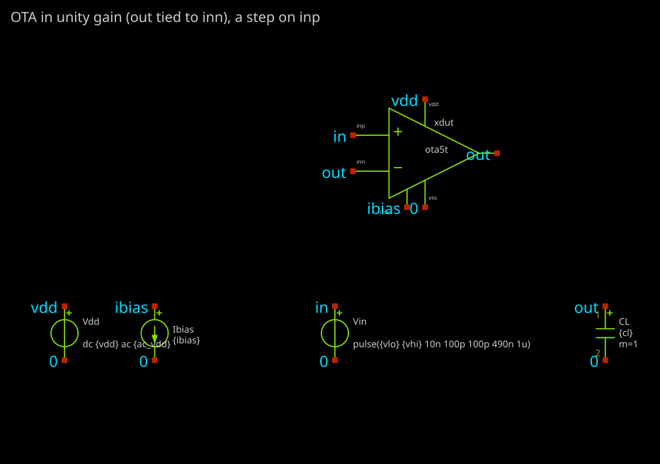

# OTA 4: the step response as a buffer

<!-- Made from cdept-gui/tutorials/ota-step.toml by `cdept tutorial ota-step --print`. Edit that file, not this one. -->

You connect the OTA as a unity-gain buffer, step its input, and relate settling and
overshoot to the AC results. Then you see slewing, by comparing a large and a small
step.

About 15 minutes. To be guided through it inside CDePT:

```sh
cdept tutorial ota-step
```

## Before you start

- [OTA 3](ota-ac.md) (its numbers are used here).

## 1. Get the project

Make the starting project.

## 2. The follower testbench

tb_ota5t_step ties out to inn: a unity-gain buffer, whose output should follow inp.
Vin steps inp from {vlo} to {vhi} at 10 ns.

From OTA 3: the loop's unity-gain frequency is 159 MHz. A first-order estimate of the
small-signal time constant is 1/(2π · 159 MHz) = 1.0 ns, and a phase margin of 60°
gives a little overshoot, around 9 % for a two-pole system.



## 3. Select tb_ota5t_step

In the Libraries panel, click the cell "tb_ota5t_step".

## 4. New testbench

Open Tools > New Testbench….

## 5. The template ota_step

Choose ota_step, the project's version of the built-in startup_settle: the same
measurements, with this bench's design variables filled in. It measures the settling
time to 1 % of the step (counted from 10 ns), the overshoot, the rise time and the
error of the final value.

## 6. Create it

Keep the view name ota_step and press "Create".

## 7. Run the 200 mV step

Press "Run": the step goes from 0.32 V to 0.52 V.

## 8. Read it

Fold "Setup". Write these down; you compare them next:

- settle_time 8.1 ns
- overshoot_pct 8.5 %: what a phase margin of 60° promised.
- t_rise 3.2 ns (10 % to 90 %)
- final_err 0.5 mV

Press "Waveform Tab" to see out step and ring once.

## 9. Now a 20 mV step

A circuit that is linear answers a 20 mV step exactly like a 200 mV step, only ten
times smaller: the same rise time. Try it. In the Simulation tab:

- in the Variables list set vlo = 0.41 and vhi = 0.43;
- under Test template set target = 0.43;
- press "Save", then "Run".

## 10. Why they differ

With 20 mV: t_rise 2.5 ns and settle_time 7.3 ns, overshoot almost unchanged (8.6 %).
The 200 mV step rises more slowly, 3.2 ns, because it is partly slewing.

When the input difference is larger than about 1.4 times the pair's vdss (here about
0.17 V), almost all the tail current goes through one side. The output can then
charge only with the tail current, 19.8 µA, whatever gm is: its slope is limited to
about I_tail / C. With about 210 fF at the output (OTA 5) that is 95 V/µs: 200 mV
takes about 2 ns at full slew. The 20 mV step never gets near that.

The final value of the small step is 0.4322 V for a target of 0.43 V: the 2.2 mV is
the offset of OTA 2 again.

Next: "OTA 5: sizing".
